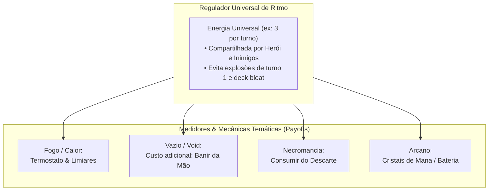
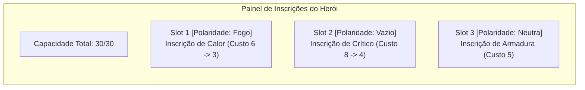
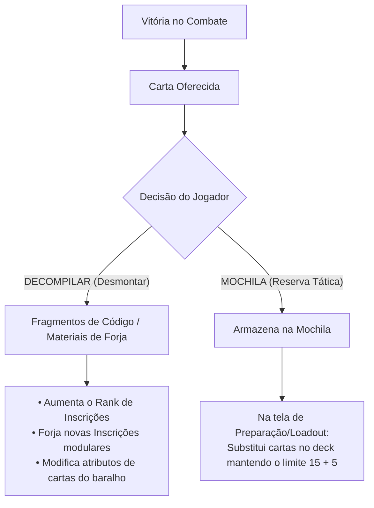

# 📜 Relatório de Direcionamento Estratégico & Game Design: HeroScript (Visão Unificada)

**Projeto:** HeroScript / Protótipo de Combate  
**Data:** Novembro de 2026 (Visão Consolidada & Unificada)  
**Documento:** Síntese Definitiva de Alinhamento de Produto, Mecânicas e Arquitetura  

---

## 1. Visão Geral & Tese do Jogo

O **HeroScript** não é um clone procedural de *Slay the Spire*, nem um TCG tradicional de mesa. O projeto define sua identidade no cruzamento entre:
* A **profundidade matemática e modular de builds de ARPGs** (*Path of Exile / Warframe*);
* A **fusão de baralhos complementares** (*Smash Up / Inscryption*);
* A **narrativa linear de personagens com estética de Light Novel / Visual Novel** (*Hades / Persona / Mega Man Battle Network*);
* O **combate como quebra-cabeça tático resolutivo sem permadeath** (*SteamWorld Quest / Into the Breach*);
* A **automação reativa de companheiros de lore** (*Gambits de Final Fantasy XII*).

> **Pitch do Jogo (Steam):**  
> *"HeroScript é um RPG tático de cartas com narrativa linear e estética marcante de Light Novel, feito sob medida para entusiastas de theorycrafting, personalização e builds profundas. Acompanhe a jornada pessoal de heróis carismáticos enquanto projeta motores de combate sinérgicos: calibre os atributos do seu personagem com Inscrições modulares de capacidade e polaridade, recombine módulos táticos mantendo um baralho enxuto de 20 cartas e decodifique o baralho dos seus oponentes batalha após batalha.*  
> *O combate trata cada confronto como um quebra-cabeça tático. Se for derrotado, não há perda de progresso nem reinício punitivo: estude as cartas do inimigo catalogadas no bestiário, ajuste as cartas da sua mochila e tente novamente até dominar o desafio."*

---

## 2. A Grande Decisão de Design: O Núcleo de Combate Unificado



### A. Por que Abandonamos as Físicas de Recursos Puramente Assimétricas?
A proposta anterior de *físicas puramente assimétricas* (onde o baralho de Fogo não gastava energia e usava apenas Calor, o do Vazio não tinha números e só bania cartas da mão, e o Arcano usava mana clássica) foi **oficialmente descontinuada**:
1. **Monopolização dos Sistemas:** Sem uma moeda universal de ação, a física do recurso precisava ser a mecânica absoluta do jogo inteiro, anulando a elegância dos outros subsistemas (Atributos, Inscrições e Companions).
2. **Desbalanceamento e Ritmo Quebrado:** Um baralho sem custo de energia permitia jogar a mão inteira no Turno 1 sem restrição de ritmo (*pacing governor*), criando pesadelos matemáticos de balanceamento.
3. **Isolamento Modular:** Cartas de temas diferentes não conversavam harmonicamente entre si nem com os inimigos.

### B. A Solução Adotada (Opção E: Energia Universal + Medidores como "Tempero Tático")
Adota-se um **núcleo de combate centralizado, legível e universal**:
* **Energia Universal por Turno:** Jogador e inimigos operam com uma reserva fixa e previsível (ex: **3 de Energia por turno**, recarregada a cada rodada). Toda carta possui um custo base de Energia (0, 1, 2, 3).
* **Meters e Palavras-Chave como Identidade (Payoffs Táticos):** Cada tema adiciona sua regra especial como modificador ou mecânica secundária:
  * **Baralho de Fogo (Calor):** Cartas custam Energia normal, mas **geram Calor (0-100)**. Cartas ganham bônus passivos massivos ao cruzar limiares (*Thresholds*, ex: Calor ≥ 50) ou descarregam todo o calor em explosões críticas.
  * **Baralho do Vazio (Void):** Cartas custam Energia normal, mas possuem o custo adicional ou aprimoramento de **Banir cartas diretamente da Mão** (*Hand Sacrifice*) para desencadear aniquilações imediatas.
  * **Baralho Necromântico:** Cartas custam Energia normal, mas interagem com o **Cemitério/Descarte** (*Graveyard Banish*), consumindo cartas descartadas para erguer barreiras e maldições.
  * **Baralho Arcano:** Cartas manipulam a estocagem de cristais ou convertem energia não gasta em barreiras duradouras.

### C. Gestão de Mão: A Bancada de Ferramentas
* **Retenção de Mão:** As cartas não gastas **permanecem na mão** no final do turno (até um limite máximo de 8 a 10 cartas).
* **Compra Cadenciada:** O jogador compra **2 a 3 cartas por turno** (em vez de descartar e comprar 5).
* **Valor Estratégico:** O descarte aleatório punitivo dá lugar ao planejamento deliberado: o jogador pode guardar a carta final de Fogo esperando o medidor de Calor atingir 80%, ou reter a carta do Vazio até comprar o "tributo" ideal.

---

## 3. Arquitetura de Baralho Modular (15 + 5) & Sem Deck Bloat

```text
┌────────────────────────────────────────────────────────────────────────┐
│                   COMPOSIÇÃO DO BARALHO (20 CARTAS)                    │
│                                                                        │
│   BARALHO PRINCIPAL DO HERÓI (15)        MÓDULO SECUNDÁRIO (5)         │
│   ├──────────────────────────────┤       ├─────────────────────────┤   │
│   │ • Identidade do Personagem   │       │ • Especialização Tática │   │
│   │ • Base de dano e defesa      │       │ • Efeitos de alto risco │   │
│   │ • Interação com Medidor Core │       │ • Manipulação de zonas  │   │
│   │   (ex: Geradores de Calor)   │       │   (ex: Banimento/Void)  │   │
│   └──────────────────────────────┘       └─────────────────────────┘   │
└────────────────────────────────────────────────────────────────────────┘
```

1. **Baralho Ativo Fixo em 20 Cartas:**
   * **15 Cartas de Herói:** Núcleo da classe/personagem da campanha.
   * **5 Cartas de Módulo Secundário:** Escolha tática flexível (ex: Módulo Void, Módulo Necro, Módulo Defensivo).
2. **Pilha Única de Compra com Reciclagem:** Os dois blocos são embaralhados juntos. As cartas transitam entre `Draw Pile -> Mão -> Descarte -> (Reembaralha)`, garantindo que o baralho recircule a cada ~4-5 turnos de forma consistente e calculável.
3. **Zona de Banimento (Vazio):** Cartas banidas saem do ciclo de reciclagem até o final do combate, criando decisões reais de custo/benefício.

---

## 4. Sistema de Inscrições de Poder (Warframe Modding Architecture)

Em vez de relíquias passivas genéricas (estilo *Slay the Spire*), a progressão e customização profunda do herói utiliza a arquitetura de **Inscrições de Poder**, inspirada nos **Mods do Warframe**:



### Regras do Sistema de Inscrições:
1. **Sem Relíquias:** Não há ganho passivo descontrolado de itens aleatórios. Toda passiva do jogador precisa ser encaixada intencionalmente no seu painel de Inscrições.
2. **Capacidade (Orçamento de Energia de Build):**
   * O herói começa com capacidade limitada (ex: 15-20 pontos).
   * A capacidade expande através de **marcos da história da campanha** e itens raros de forja (*Reatores/Catalisadores*).
3. **Polaridades de Slot:**
   * Cada slot do herói possui uma polaridade (ex: *Fogo, Vazio, Arcano, Neutra*).
   * **Polaridade Correspondente:** O custo da inscrição cai pela metade (arredondado para cima).
   * **Polaridade Incompatível:** O custo da inscrição aumenta em 25%.
   * **Slot Neutro:** Custo normal sem modificador.
4. **Ranks de Aprimoramento:** Inscrições possuem níveis (Rank 0 a Rank 5/10). Aumentar o rank eleva os valores dos bônus, mas também aumenta a capacidade exigida.
5. **Tipos de Inscrições:**
   * **Inscrições de Núcleo:** Afetam atributos globais (Vida Máxima, Escudo Base, Multiplicador de Crítico, Dano por Tag).
   * **Inscrições de Cartas:** Acopladas a regras específicas de cartas (ex: *"Cartas com a tag Fogo aplicam +2 Chamas extras"*).

---

## 5. Campanha Linear, Narrativa Light Novel & Puzzle Tático

### A. Estrutura de Campanha Linear (Zero Permadeath)
* O jogo é estruturado em **capítulos lineares por personagem** (ex: 8 a 12 combates desenhados a mão por arco narrativo).
* **Filosofia da Derrota:** Morrer em combate **nunca reinicia a campanha**. A derrota é um convite ao theorycrafting:
  > *"Você caiu diante do Golem de Magma. Nenhum progresso foi perdido. Abra o seu Loadout, reconfigure suas Inscrições e suas cartas da Mochila, e tente novamente!"*

### B. Narrativa no Estilo Light Novel
* Diálogos ilustrados no formato **Visual Novel** antes e após as batalhas fundamentais.
* **Companions com Personalidade:** O Elemental da Água não é uma passiva sem rosto; ele participa das conversas, expressa opiniões, debate estratégias com o herói e solta falas curtas de combate (*barks*).

### C. Inimigos Inteligentes & Scouting Progressivo (Bestiário Tático)
* **Inimigos têm Baralhos Reais:** Inimigos não usam mecânicas arbitrárias de dano mágico opaco; eles jogam com o mesmo sistema de regras do jogador (energia, cartas, status e tags).
* **O Sistema de Scouting (Reconhecimento Progressivo):**
  1. *Primeiro Encontro:* O jogador vê a silhueta, atributos básicos e o arquétipo do inimigo. As cartas da mão do inimigo são incógnitas.
  2. *Durante o Combate:* Cada carta jogada pelo oponente é catalogada e revelada em tempo real na interface do bestiário.
  3. *Revanche / Estudo Tático:* Ao ser derrotado ou ao inspecionar o inimigo, o jogador tem acesso à lista das cartas prováveis do oponente.
  4. *Resultado:* O combate torna-se um **quebra-cabeça tático decodificável** (estilo *Into the Breach* e chefes de *Mega Man*), recompensando quem estuda as fraquezas do adversário.

---

## 6. O Loop de Recompensas: "Decompilar" vs. "Mochila"

Ao vencer uma batalha na campanha, a carta recebida **nunca entra diretamente no baralho ativo**. O jogador é colocado diante de uma decisão deliberada:



1. **Decompilar (Desmontagem / Scrap):**
   * Transforma a carta em materiais de forja (*Fragmentos de Código / Endo*).
   * Permite evoluir os ranks das Inscrições e aplicar mutações controladas nas cartas já existentes do herói.
   * Mantém o baralho focado, denso e sem cartas "lixo".
2. **Guardar na Mochila (Sideboard Tático):**
   * Armazena a carta na reserva de estratégia.
   * Permite que o jogador altere o módulo de 5 cartas secundárias ou refine as 15 cartas principais antes de enfrentar um chefe específico na tela de Loadout.

---

## 7. O Modo Roguelike (Arcade / Endgame)

O modo Roguelike existe como uma **experiência arcade complementar** para quem terminou a história ou deseja testar builds extremas:
* **Aproveitamento Total de Conteúdo:** Utiliza todos os inimigos, chefes, cartas e inscrições desenvolvidos para a campanha.
* **Baralhos Híbridos dos Inimigos:**
  * **60% a 70% Núcleo Fixo:** Cartas que definem o arquétipo e o comportamento legível da IA do inimigo.
  * **30% a 40% Cartas Auxiliares Aleatórias:** Sorteadas a partir de uma tabela temática para garantir variedade e surpresa entre runs.

---

## 8. Arquitetura Técnica & Engine HeroScript (C# Core)

A engine C# do HeroScript é perfeitamente alinhada com esta visão de design:
1. **Pipeline de Atributos Determinístico:**
   $$\text{Valor Final} = (\text{Base} + \text{Flat}) \times (1 + \sum \text{Increased}) \times \prod \text{More}$$
2. **Arquitetura Baseada em Tags:** Cartas, efeitos, atributos e inimigos comunicam-se via tags (`Fogo`, `Vazio`, `Feitiço`, `Ataque`, `Crítico`). As Inscrições bonificam tags específicas, viabilizando sinergias cruzadas intuitivas.
3. **Barramento de Eventos e Fila de Ações:** Resolução determinística e sem corridas assíncronas no modelo `Gatilho -> Condição -> Ação`.
4. **Data-Driven (JSON Puro):** O motor de jogo processa dados. Todo herói, carta, inimigo e inscrição é declarado em arquivos JSON, permitindo balanceamento ágil e suporte total a modding.

---

## 9. Próximos Passos & Protótipo Mínimo Jogável (Vertical Slice)

1. **Combate Base com Energia Universal:**
   * Implementar o custo universal de 3 de Energia por turno no fluxo de jogo.
   * Configurar a mão com retenção e compra de 2 cartas por rodada (teto de 8 cartas).
2. **Configuração de Cartas de Teste (`data/configs/prototype-test`):**
   * **15 Cartas do Piromaníaco (Fogo):** Custam energia e geram Calor; cartas ganham bônus de dano ou condensação quando Calor ≥ 50.
   * **5 Cartas do Módulo Void:** Custam energia + o requisito adicional de banir 1 carta da mão para aplicar dano massivo ou perfuração.
3. **Companion Inicial (Elemental da Água):**
   * Gatilho reativo: ao jogar carta de Fogo, aplica `Molhado` no alvo (Cooldown de 2 turnos).
4. **Telas de Fluxo de Campanha:**
   * Tela de Vitória: Opção de **Decompilar** vs. **Guardar na Mochila**.
   * Tela de Derrota: Opção amigável de **[Ajustar Loadout]** e **[Tentar Novamente]**.
