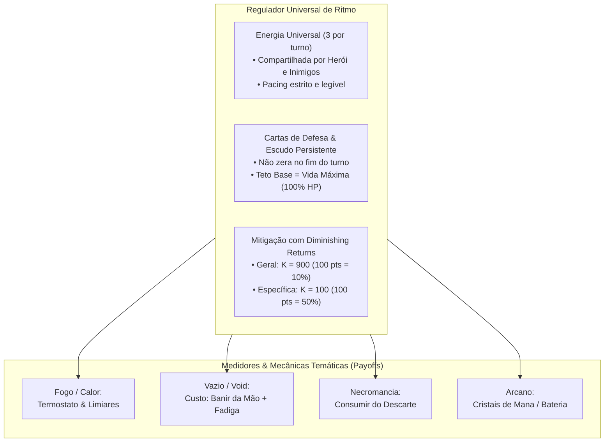
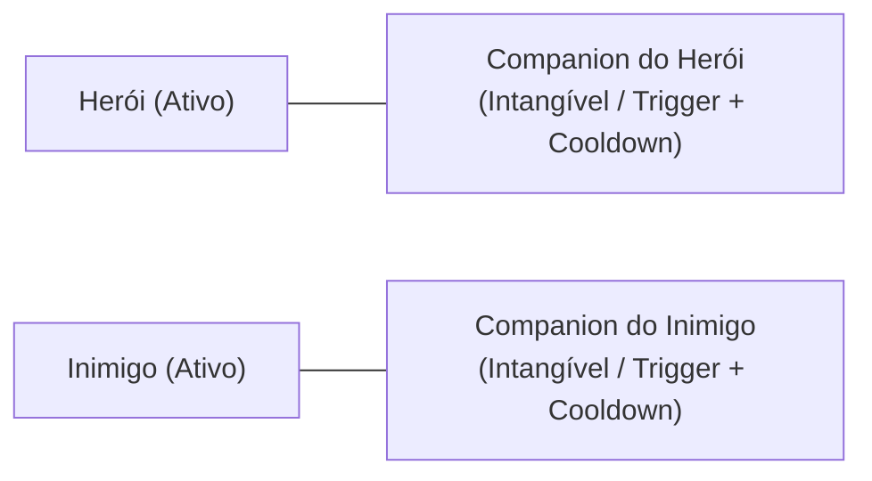
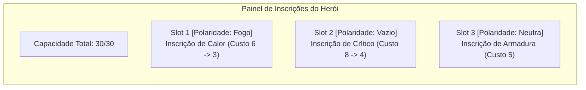
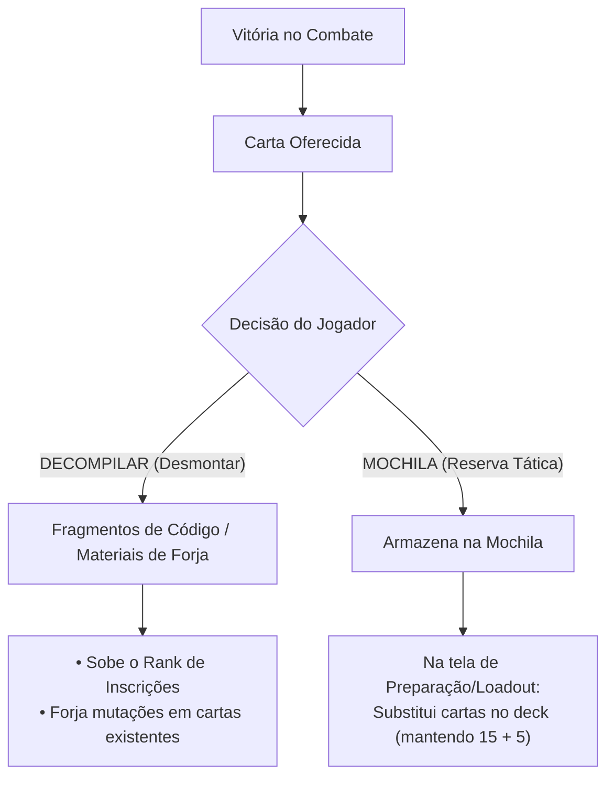

# 📜 Relatório de Direcionamento Estratégico & Game Design: HeroScript (Visão Unificada)

**Projeto:** HeroScript / Protótipo de Combate  
**Data:** Novembro de 2026 (Visão Consolidada & Validada em Playtest)  
**Documento:** Síntese Definitiva de Alinhamento de Produto, Mecânicas e Arquitetura  

---

## 1. Visão Geral & Tese do Jogo

O **HeroScript** não é um clone procedural de *Slay the Spire*, nem um TCG tradicional de mesa. O projeto define sua identidade no cruzamento entre:
* A **profundidade matemática e modular de builds de ARPGs** (*Path of Exile / Warframe*);
* A **fusão de baralhos complementares** (*Smash Up / Inscryption*);
* A **narrativa linear de personagens com estética de Light Novel / Visual Novel** (*Library of Ruina / Hades / Mega Man Battle Network*);
* O **combate como quebra-cabeça tático resolutivo sem permadeath** (*SteamWorld Quest / Into the Breach*);
* A **automação reativa de companheiros de lore** (*Gambits de Final Fantasy XII*).

> **Pitch do Jogo (Steam):**  
> *"HeroScript é um RPG tático de cartas com narrativa linear e estética marcante de Light Novel, feito sob medida para entusiastas de theorycrafting, personalização e builds profundas. Acompanhe a jornada pessoal de heróis carismáticos enquanto projeta motores de combate sinérgicos: calibre os atributos do seu personagem com Inscrições modulares de capacidade e polaridade, recombine módulos táticos mantendo um baralho enxuto de 20 cartas e decodifique o baralho dos seus oponentes batalha após batalha.*  
> *O combate trata cada confronto como um quebra-cabeça tático. Se for derrotado, não há perda de progresso nem reinício punitivo: estude as cartas do inimigo catalogadas no bestiário, ajuste as cartas da sua mochila e tente novamente até dominar o desafio."*

---

## 2. O Núcleo de Combate Unificado: Energia & Defesa



### A. Abandono das Físicas Assimétricas Exclusivas
Físicas que eliminavam o custo de energia (ex: baralho que só usava calor sem energia) foram **descontinuadas**. Elas monopolizavam o jogo inteiro, quebravam o ritmo no Turno 1 e impediam a integração equilibrada com atributos e inimigos.

### B. A Moeda Universal de Ação (Opção E: Energia Universal + Medidores)
* **3 de Energia por Turno:** Padrão para herói e inimigos, recarregada no início de cada rodada.
* **Meters como Payoffs:** Calor (0-100), Cristais e Sacrifício de Zonas atuam como regras secundárias e multiplicadores de impacto, nunca como substitutos da energia de ação.

### C. A Mecânica de Defesa: Cartas de Defesa, Escudo Persistente & Teto de Vida
Após testes práticos de protótipo, a dinâmica defensiva foi ajustada para garantir a melhor experiência tática:
1. **Resultado de Playtest (O Fim do Escudo Fixo Passivo):** O escudo passivo automático todo turno foi descartado por gerar sensação de "vida inflada artificial", anular cartas de ataque leves (*primers* com dano menor que o escudo) e eliminar o dilema do jogador sobre quando atacar ou se defender.
2. **Retorno das Cartas de Defesa Ativas:** O Escudo é gerado ativamente por cartas que carregam a tag de função `[Defesa]`, combinada com a tag de elemento (ex: `[Fogo, Defesa]`, `[Vazio, Defesa]`).
3. **Escudo Persistente (Zero Desperdício de Energia):**
   * O escudo gerado por cartas **NÃO zera no final do turno** (estilo a Armadura de *Hearthstone* ou Escudos de *Warframe*).
   * Se o jogador gastar energia com defesa e o inimigo não atacar naquele turno, o escudo permanece intacto para as próximas rodadas.
4. **Teto Máximo de Escudo = Vida Máxima do Herói (100% HP):**
   * Por padrão, o herói só pode estocar escudo até o limite da sua Vida Máxima (ex: 50 HP = máx. 50 de Escudo).
   * **Espaço para Builds & Inscrições (Overshields):**
     * Inscrições podem alterar esse multiplicador (ex: *Inscrição de Bateria: Teto de Escudo = Vida × 2*).
     * Inscrições podem viabilizar arquétipos de impacto (*Shield Slam*: causa dano proporcional ao Escudo estocado).
5. **Escalonamento por Atributos:** O atributo defensivo do herói (*Tenacidade / Armadura*) não gera escudo do nada, mas multiplica o valor concedido pelas cartas de defesa:
   $$\text{Escudo Concedido} = (\text{Base da Carta} + \text{Flat}) \times (1 + \text{Atributo de Defesa})$$

### D. Sistema de Mitigação de Dano com Diminishing Returns (Dual-K)
Para evitar que heróis ou inimigos se tornem invulneráveis, a redução percentual de dano adota a fórmula assintótica clássica de retornos decrescentes:

$$\text{Redução de Dano (\%)} = \frac{\text{Rating}}{\text{Rating} + K}$$

* **Sem Invulnerabilidade:** A fórmula aproxima-se assintoticamente de 100%, mas nunca atinge a imunidade absoluta.
* **Arquitetura Dual-K (Específico vs. Geral):**
  Defesas especializadas devem ser substancialmente mais potentes por ponto do que defesas gerais, valorizando diretamente a preparação de build e o *Scouting*:
  1. **Mitigação Geral (Armadura Universal):** $K_{\text{geral}} = 900$.
     * Protege contra todos os tipos de dano.
     * $100 \text{ pontos} \implies 10\%$ de redução.
     * $300 \text{ pontos} \implies 25\%$ de redução.
     * $900 \text{ pontos} \implies 50\%$ de redução.
  2. **Mitigação Específica (Resistência por Tag Elementar, ex: Fogo, Vazio):** $K_{\text{específico}} = 100$.
     * Protege apenas contra o elemento correspondente.
     * $25 \text{ pontos} \implies 20\%$ de redução.
     * $50 \text{ pontos} \implies 33,3\%$ de redução.
     * $100 \text{ pontos} \implies 50\%$ de redução (dano do elemento cortado pela metade!).
     * $300 \text{ pontos} \implies 75\%$ de redução.
* **Ordem de Resolução de Dano no Combate:**
  $$\text{Dano Bruto} \longrightarrow \text{Mitigações (Geral \& Específica)} \longrightarrow \text{Escudo Persistente} \longrightarrow \text{Vida (HP)}$$
  * O Escudo ganha **Vida Efetiva (EHP)** multiplicada: quanto maior a resistência, mais o Escudo dura antes de ser perfurado.

### E. Gestão de Mão: A Bancada de Ferramentas
* **Retenção de Mão:** Cartas não jogadas permanecem na mão (limite de 8 a 10 cartas).
* **Compra Cadenciada:** Compra padrão de **2 a 3 cartas por turno**, permitindo planejamento e estocagem premeditada de combos.

---

## 3. Arquitetura de Baralho Modular (15 + 5), Zonas & Fadiga

```text
┌────────────────────────────────────────────────────────────────────────┐
│                   COMPOSIÇÃO DO BARALHO (20 CARTAS)                    │
│                                                                        │
│   BARALHO PRINCIPAL DO HERÓI (15)        MÓDULO SECUNDÁRIO (5)         │
│   ├──────────────────────────────┤       ├─────────────────────────┤   │
│   │ • Identidade do Personagem   │       │ • Especialização Tática │   │
│   │ • Base de dano e defesa      │       │ • Efeitos de alto risco │   │
│   │ • Interação com Medidor Core │       │ • Manipulação de zonas  │   │
│   │   (ex: Geradores de Calor)   │       │   (ex: Banimento/Void)  │   │
│   └──────────────────────────────┘       └─────────────────────────┘   │
└────────────────────────────────────────────────────────────────────────┘
```

1. **Baralho Ativo Enxuto (20 Cartas):**
   * **15 Cartas de Herói + 5 Cartas de Módulo:** Baralho de compra único com reciclagem contínua (`Draw Pile -> Mão -> Descarte -> Reembaralha`) a cada ~4-5 turnos.
   * *Status de Flexibilidade (Hipótese sob Teste):* O protótipo inicia travado estritamente na proporção 15/5. Avaliaremos em playtesting se permitir proporções assimétricas (ex: 12/8 ou 10/10) enriquece ou dilui a identidade das classes.
2. **Zona de Banimento (Vazio) & Risco de Deck Thinning:**
   * Banir cartas da mão afina o baralho para comprar combos mais rápido.
   * **Mecânica de Fadiga:** Para evitar loops infinitos onde o jogador bane quase tudo e joga as mesmas 4 cartas todo turno, o esgotamento do baralho de compra aplica **Dano de Fadiga** progressivo e cumulativo diretamente na vida a cada compra frustrada.
3. **Mecânica de Resgate Temporal:**
   * Módulos do Vazio possuem cartas de utilidade que devolvem cartas da zona de Banimento para a mão ou descarte, viabilizando ciclos calculados de sacrifício e recuperação.

---

## 4. Companions: Identidade, Intangibilidade & Controle



1. **Entidades Intangíveis:**
   * Companions (tanto do herói quanto dos inimigos) **não possuem barra de vida própria** e não podem ser destruídos por ataques normais.
   * A arena de combate permanece um duelo focado e limpo entre duas barras de vida principais.
2. **Automação Reativa (Trigger + Cooldown):**
   * Exemplo: *Elemental da Água* possui a regra: *"Ao jogar carta com a tag Fogo, aplica Molhado no alvo (Cooldown: 2 turnos)"*.
3. **Mecânicas de Interferência Tática:**
   * Embora imunes à morte, companions podem ser neutralizados temporariamente por cartas e efeitos de controle:
     * **Sono / Sleep:** Coloca o companion em repouso por X turnos, impedindo que seus gatilhos disparem.
     * **Sobrecarga / Atraso de Cooldown:** Aumenta o tempo de recarga restante do companion em +1 ou +2 turnos.

---

## 5. Sistema de Inscrições de Poder (Warframe Modding Architecture)



### Regras do Sistema:
1. **Sem Relíquias:** Toda passiva decorre de Inscrições inseridas intencionalmente no painel do herói.
2. **Capacidade & Polaridades:**
   * Capacidade começa em 15-20 e expande na campanha.
   * Polaridade compatível reduz o custo pela metade; polaridade incompatível aumenta o custo em 25%.
3. **Economia & Obtenção Híbrida de Inscrições:**
   * **Marcos Fixos da História:** Chefes de capítulo e eventos dramáticos garantem Inscrições centrais e expansões permanentes de Capacidade (*Reatores*).
   * **Variedade & Aleatoriedade Controlada:** Encontros opcionais, elites de fenda e comerciantes trazem seleções semi-aleatórias de Inscrições, garantindo que runs diferentes possuam variações de theorycrafting.
   * **Ranks de Aprimoramento:** Inscrições sobem de nível (Rank 0 a Rank 5/10) consumindo materiais gerados pela Decompilação de cartas.

---

## 6. Campanha Linear, Narrativa Light Novel & Puzzle Tático

### A. Estrutura de Campanha Linear (Zero Permadeath)
* Capítulos desenhados a mão com arcos dramáticos individuais por herói.
* **Derrota sem Punição:** Ao ser derrotado, nenhum progresso é apagado. O jogo convida o jogador a abrir o Loadout, alterar a Mochila e as Inscrições com base no que aprendeu e tentar novamente.
* **Regra de Ouro de UX:** Botão de **Skip imediato** e **zero repetição de diálogo** ao tentar novamente uma luta (*retry*).

### B. Inimigos Inteligentes & Scouting Progressivo
* Inimigos usam baralhos reais e obedecem às mesmas regras de energia, tags e escudo persistente.
* **Bestiário Progressivo:**
  1. *1º Encontro:* Silhueta e atributos base revelados.
  2. *Durante o Combate:* Cartas jogadas pelo oponente são catalogadas e passam a exibir seus efeitos.
  3. *Revanche:* O jogador visualiza o baralho provável do inimigo, transformando a derrota em um **quebra-cabeça tático resolúvel**.

---

## 7. O Loop de Recompensas: "Decompilar" vs. "Mochila"



1. **Decompilar (Desmontagem / Scrap):** Fornece recursos para upar Inscrições e condensar o poder sem inchar o baralho ativo.
2. **Mochila (Reserva Tática):** Sideboard flexível para ajustar o deck ativo antes de batalhas desafiadoras.

---

## 8. Arquitetura Técnica & Engine HeroScript (C# Core)

1. **Pipeline de Atributos & Resolução de Dano:**
   * **Cálculo de Saída da Carta:**
     $$\text{Valor da Carta} = (\text{Base} + \text{Flat}) \times (1 + \sum \text{Increased}) \times \prod \text{More}$$
   * **Resolução de Mitigação de Dano Recebido:**
     $$\text{Dano Mitigado} = \text{Dano Bruto} \times \left(1 - \frac{\text{Armadura}}{\text{Armadura} + 900}\right) \times \left(1 - \frac{\text{Resistência}_{\text{Tag}}}{\text{Resistência}_{\text{Tag}} + 100}\right)$$
     O dano resultante subtrai primeiramente do Escudo Persistente; o excedente reduz a Vida (HP).
2. **Arquitetura de Tags Ortogonais (Elemento + Função):**
   * As tags **não embutem efeitos ocultos automáticos** (o que engessaria o design). Elas atuam como marcadores ortogonais em dois eixos:
     * **Eixo Elementar / Origem:** `Fogo`, `Vazio`, `Sombra`, `Divino`, `Arcano`.
     * **Eixo Funcional / Papel:** `Ataque`, `Defesa`, `Buff`, `Postura`, `Feitiço`.
   * **Inscrições Operam em Interseções:** As Inscrições filtram regras combinadas (ex: *"Ataques de [Fogo] aplicam +2 Queimaduras"*; *"Defesas de [Fogo] geram +10 de Calor"*). Isso garante que um buff de fogo nunca queime o próprio herói e que defesas de fogo não ativem gatilhos ofensivos indevidos.
3. **Anatomia & Apresentação Visual da Carta:**
   * **Custo de Uso (Energia):** Posicionado no **canto superior direito** da carta (na linha do cabeçalho).
   * **Título da Carta:** Topo esquerdo do cabeçalho.
   * **Tags de Origem (Elemento):** Posicionadas diretamente **embaixo do título da carta** (ex: `[Fogo]`, `[Vazio]`, `[Sombra]`), permitindo leitura imediata da afinidade elementar antes da arte.
   * **Área Central:** Arte/Ilustração (`ArtSlot`).
   * **Corpo da Carta:** Tag de Função (`[Ataque]`, `[Defesa]`, `[Buff]`, `[Postura]`) e texto explicativo com números coloridos pelo scaling de atributos.

```text
┌──────────────────────────────────────────────┐
│  [NOME DA CARTA]                  (⚡ CUSTO) │
│  🏷️ [TAGS DE ORIGEM: ex: FOGO / VAZIO]       │
├──────────────────────────────────────────────┤
│                                              │
│             [ARTE DA CARTA]                  │
│                                              │
├──────────────────────────────────────────────┤
│  [TAG DE FUNÇÃO: ATAQUE / DEFESA / BUFF]     │
│  Descrição do efeito com escalonamento...    │
└──────────────────────────────────────────────┘
```

4. **Barramento de Eventos e Fila de Ações:** Modelo estrito `Gatilho -> Condição -> Ação`.
5. **Data-Driven Total (JSON):** Cartas, inimigos, companions e inscrições declarados em dados.

---

## 9. Próximos Passos & Protótipo Mínimo Jogável (Vertical Slice)

1. **Combate Base com Energia, Escudo Persistente & Mitigação Dual-K:**
   * 3 de Energia por turno + Cartas com tag `[Defesa]` gerando Escudo Persistente.
   * Teto Máximo de Escudo inicial travado em 100% da Vida Máxima do Herói (com suporte a mods multiplicadores).
   * Mitigação por fórmula assintótica ($K=900$ geral, $K=100$ específico).
   * Mão retida com compra de 2 a 3 cartas por turno.
2. **Configuração de Cartas de Teste (`data/configs/prototype-test`):**
   * **15 Cartas do Piromaníaco (Fogo):** Divididas entre `[Ataque, Fogo]`, `[Defesa, Fogo]` e `[Buff, Fogo]`; geram/gastam Calor; bônus em limiares.
   * **5 Cartas do Vazio:** Custam energia + banir da mão; cartas de alto risco/recompensa; risco de fadiga se esgotar o baralho.
3. **Companion Inicial (Elemental da Água):**
   * Intangível; aplica `Molhado` em gatilho de carta de Fogo (Cooldown 2 turnos); suporte a status de `Sleep`.
4. **Telas de Fluxo de Campanha:**
   * Vitória: Decompilar vs Mochila.
   * Derrota: [Ajustar Baralho] e [Tentar Novamente] instantâneo sem diálogo.
