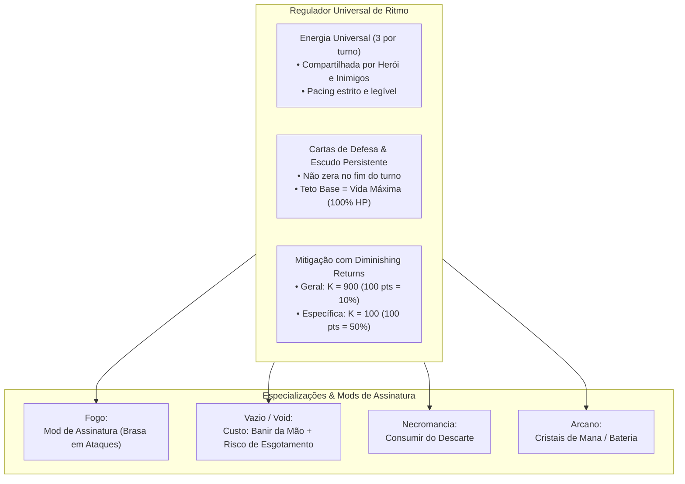
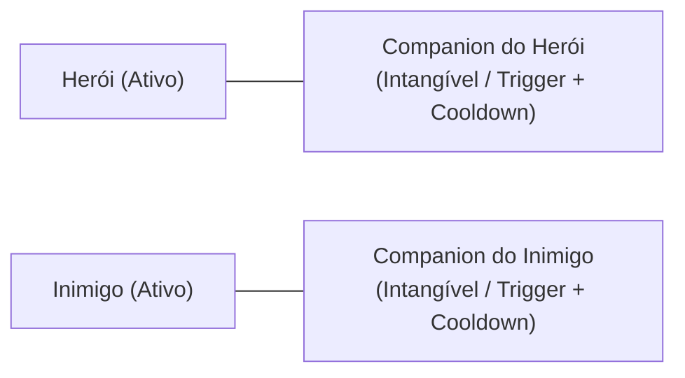
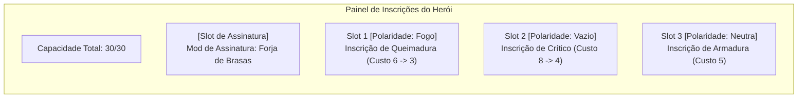
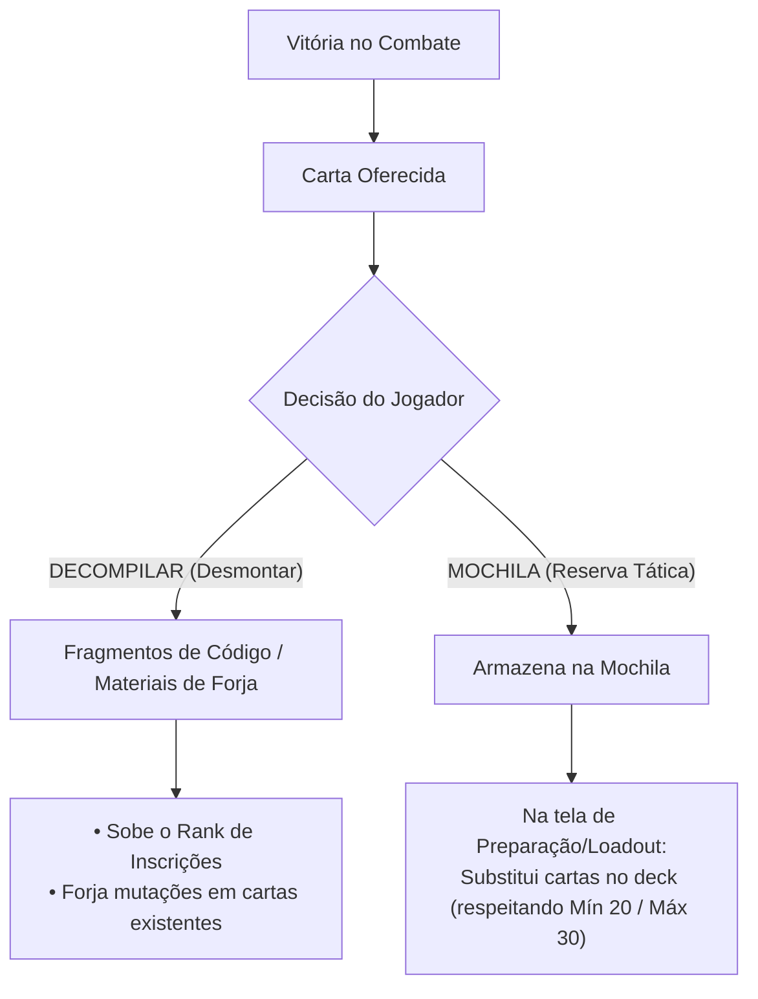

# 📜 Relatório de Direcionamento Estratégico & Game Design: HeroScript (Visão Unificada)

**Projeto:** HeroScript / Protótipo de Combate  
**Data:** Novembro de 2026 (Visão Consolidada & Validada em Playtest)  
**Documento:** Síntese Definitiva de Alinhamento de Produto, Mecânicas e Arquitetura  

---

## 1. Visão Geral & Tese do Jogo

O **HeroScript** não é um clone procedural de *Slay the Spire*, nem um TCG tradicional de mesa. O projeto define sua identidade no cruzamento entre:
* A **profundidade matemática e modular de builds de ARPGs** (*Path of Exile / Warframe*);
* A **fusão de baralhos complementares** (*Smash Up / Inscryption*);
* A **narrativa linear de personagens com estética de Light Novel / Visual Novel** (*Library of Ruina / Hades / Mega Man Battle Network*);
* O **combate como quebra-cabeça tático resolutivo sem permadeath** (*SteamWorld Quest / Into the Breach*);
* A **automação reativa de companheiros de lore** (*Gambits de Final Fantasy XII*).

> **Pitch do Jogo (Steam):**  
> *"HeroScript é um RPG tático de cartas com narrativa linear e estética marcante de Light Novel, feito sob medida para entusiastas de theorycrafting, personalização e builds profundas. Acompanhe a jornada pessoal de heróis carismáticos enquanto projeta motores de combate sinérgicos: calibre os atributos do seu personagem com Inscrições modulares de capacidade e polaridade, recombine módulos táticos mantendo um baralho enxuto de 20 cartas e decodifique o baralho dos seus oponentes batalha após batalha.*  
> *O combate trata cada confronto como um quebra-cabeça tático. Se for derrotado, não há perda de progresso nem reinício punitivo: estude as cartas do inimigo catalogadas no bestiário, ajuste as cartas da sua mochila e tente novamente até dominar o desafio."*

---

## 2. O Núcleo de Combate Unificado: Energia & Defesa



### A. Abandono das Físicas Assimétricas Exclusivas e Medidores Passivos
Físicas que eliminavam o custo de energia ou criavam medidores contínuos burocráticos (como a antiga barra de Calor 0-100) foram **descontinuadas**. Elas monopolizavam o jogo, quebravam o ritmo no Turno 1 e agiam apenas como uma "segunda mana" passiva sem decisão real.

### B. A Moeda Universal de Ação (Opção E: Energia Universal + Mecânicas Ativas)
* **3 de Energia por Turno:** Padrão para herói e inimigos, recarregada no início de cada rodada.
* **Mecânicas Especiais via Mods de Assinatura:** Em vez de barras genéricas na UI, cada escola e herói opera com regras ativas e táteis (ex: marcadores de Brasa em ataques retidos, estocagem de cristais, banimento de cartas).

### C. A Mecânica de Defesa: Cartas de Defesa, Escudo Persistente & Teto de Vida
Após testes práticos de protótipo, a dinâmica defensiva foi ajustada para garantir a melhor experiência tática:
1. **Resultado de Playtest (O Fim do Escudo Fixo Passivo):** O escudo passivo automático todo turno foi descartado por gerar sensação de "vida inflada artificial", anular cartas de ataque leves (*primers* com dano menor que o escudo) e eliminar o dilema do jogador sobre quando atacar ou se defender.
2. **Retorno das Cartas de Defesa Ativas:** O Escudo é gerado ativamente por cartas que carregam a tag de função `[Defesa]`, combinada com a tag de elemento (ex: `[Fogo, Defesa]`, `[Vazio, Defesa]`).
3. **Escudo Persistente (Zero Desperdício de Energia):**
   * O escudo gerado por cartas **NÃO zera no final do turno** (estilo a Armadura de *Hearthstone* ou Escudos de *Warframe*).
   * Se o jogador gastar energia com defesa e o inimigo não atacar naquele turno, o escudo permanece intacto para as próximas rodadas.
4. **Teto Máximo de Escudo = Vida Máxima do Herói (100% HP):**
   * Por padrão, o herói só pode estocar escudo até o limite da sua Vida Máxima (ex: 50 HP = máx. 50 de Escudo).
   * **Espaço para Builds & Inscrições (Overshields):**
     * Inscrições podem alterar esse multiplicador (ex: *Inscrição de Bateria: Teto de Escudo = Vida × 2*).
     * Inscrições podem viabilizar arquétipos de impacto (*Shield Slam*: causa dano proporcional ao Escudo estocado).
5. **Escalonamento por Atributos:** O atributo defensivo do herói (*Tenacidade / Armadura*) não gera escudo do nada, mas multiplica o valor concedido pelas cartas de defesa:
   $$\text{Escudo Concedido} = (\text{Base da Carta} + \text{Flat}) \times (1 + \text{Atributo de Defesa})$$

### D. Sistema de Mitigação de Dano com Diminishing Returns (Dual-K)
Para evitar que heróis ou inimigos se tornem invulneráveis, a redução percentual de dano adota a fórmula assintótica clássica de retornos decrescentes:

$$\text{Redução de Dano (\%)} = \frac{\text{Rating}}{\text{Rating} + K}$$

* **Sem Invulnerabilidade:** A fórmula aproxima-se assintoticamente de 100%, mas nunca atinge a imunidade absoluta.
* **Arquitetura Dual-K (Específico vs. Geral):**
  Defesas especializadas devem ser substancialmente mais potentes por ponto do que defesas gerais, valorizando diretamente a preparação de build e o *Scouting*:
  1. **Mitigação Geral (Armadura Universal):** $K_{\text{geral}} = 900$.
     * Protege contra todos os tipos de dano.
     * $100 \text{ pontos} \implies 10\%$ de redução.
     * $300 \text{ pontos} \implies 25\%$ de redução.
     * $900 \text{ pontos} \implies 50\%$ de redução.
  2. **Mitigação Específica (Resistência por Tag Elementar, ex: Fogo, Vazio):** $K_{\text{específico}} = 100$.
     * Protege apenas contra o elemento correspondente.
     * $25 \text{ pontos} \implies 20\%$ de redução.
     * $50 \text{ pontos} \implies 33,3\%$ de redução.
     * $100 \text{ pontos} \implies 50\%$ de redução (dano do elemento cortado pela metade!).
     * $300 \text{ pontos} \implies 75\%$ de redução.
* **Ordem de Resolução de Dano no Combate:**
  $$\text{Dano Bruto} \longrightarrow \text{Mitigações (Geral \& Específica)} \longrightarrow \text{Escudo Persistente} \longrightarrow \text{Vida (HP)}$$
  * O Escudo ganha **Vida Efetiva (EHP)** multiplicada: quanto maior a resistência, mais o Escudo dura antes de ser perfurado.

### E. Gestão de Mão: A Bancada de Ferramentas
* **Retenção de Mão:** Cartas não jogadas permanecem na mão (limite de 8 a 10 cartas).
* **Compra Cadenciada:** Compra padrão de **2 a 3 cartas por turno**, permitindo planejamento e estocagem premeditada de combos.

---

## 3. Arquitetura de Baralho: O Baralho do Herói (Mín. 20 / Máx. 30), Zonas & Mochila

```text
┌────────────────────────────────────────────────────────────────────────┐
│                   COMPOSIÇÃO DO BARALHO ATIVO                          │
│                                                                        │
│   FAIXA PADRÃO DE TAMANHO                    MECÂNICA DA MOCHILA       │
│   ├──────────────────────────────┤           ├─────────────────────┤   │
│   │ • MÍNIMO Padrão: 20 cartas   │           │ • Troca livre fora  │   │
│   │   (Protege contra esgotamento│ ◄───────► │   de combate        │   │
│   │    e garante consistência)   │           │ • Zero ansiedade    │   │
│   │ • MÁXIMO Padrão: 30 cartas   │           │   de draft          │   │
│   │   (Permite cartas de Vazio e │           │ • Decompilar a      │   │
│   │    ferramentas situacionais) │           │   qualquer momento  │   │
│   └──────────────────────────────┘           └─────────────────────┘   │
└────────────────────────────────────────────────────────────────────────┘
```

1. **Baralho Inicial & Descoberta na Campanha:**
   * O jogador começa com um **Baralho Básico do Herói** (20 cartas da sua classe inicial).
   * Conforme avança na história e vence duelos, ganha novas cartas de outras escolas (Vazio, Sombra, Elites) que vão para a **Mochila**.
2. **Faixa Tática Padrão (Mínimo 20 / Máximo 30 cartas):**
   * **20 Cartas (Deck Enxuto):** Consistência máxima para ciclar combos rapidamente a cada 3 a 4 turnos.
   * **25 a 30 Cartas (Deck Volumoso):** Fornece combustível essencial para builds de **Vazio** (que banem cartas da mão) sem risco de sofrer Derrota por Esgotamento (Deck-Out), além de permitir cartas situacionais de resposta (*Toolbox*).
3. **Mochila como Arsenal Tático (Anti-Deck Bloat):**
   * Fora de combate (no Loadout ou Acampamento), o jogador **adiciona e remove cartas livremente** entre o Baralho Ativo e a Mochila, sem nenhum custo em ouro ou recursos.
   * Cartas obsoletas ou indesejadas podem ser **Decompiladas** a qualquer momento para gerar materiais de evolução de Inscrições.
4. **Zona de Banimento (Vazio) & Condição de Derrota por Esgotamento (Deck-Out):**
   * **Reciclagem Normal Infinita:** Em combate padrão, quando a Pilha de Compra esvazia, a Pilha de Descarte é imediatamente reembaralhada. O ciclo é infinito e cartas comuns nunca esgotam o baralho.
   * **A Regra de Deck-Out (Derrota Instantânea):** Se uma entidade (herói ou inimigo) precisar comprar cartas no início do turno e **não houver nenhuma carta na Pilha de Compra nem no Descarte** (devido a cartas terem sido banidas para o Vazio), ela sofre **Derrota Imediata por Colapso / Esgotamento Total**.
   * **Tensão Máxima para o Vazio:** O Vazio atua como um pacto de alto risco — banir cartas afina o baralho e acelera combos, mas queimar cartas em excesso aproxima o jogador da derrota fulminante.
   * **Vitória Alternativa (Mill):** A regra é simétrica! Se o jogador utilizar cartas que banem o baralho do oponente, pode derrotar um chefe hiper-resistente esgotando o deck dele.
5. **Mecânica de Resgate Temporal:**
   * Cartas de utilidade do Vazio permitem resgatar cartas banidas de volta ao ciclo ativo para loops calculados de sacrifício.

---

## 4. Companions: Identidade, Intangibilidade & Controle



1. **Entidades Intangíveis:**
   * Companions (tanto do herói quanto dos inimigos) **não possuem barra de vida própria** e não podem ser destruídos por ataques normais.
   * A arena de combate permanece um duelo focado e limpo entre duas barras de vida principais.
2. **Automação Reativa (Trigger + Cooldown):**
   * Exemplo: *Elemental da Água* possui a regra: *"Ao jogar carta com a tag Fogo, aplica Molhado no alvo (Cooldown: 2 turnos)"*.
3. **Mecânicas de Interferência Tática:**
   * Embora imunes à morte, companions podem ser neutralizados temporariamente por cartas e efeitos de controle:
     * **Sono / Sleep:** Coloca o companion em repouso por X turnos, impedindo que seus gatilhos disparem.
     * **Sobrecarga / Atraso de Cooldown:** Aumenta o tempo de recarga restante do companion em +1 ou +2 turnos.

---

## 5. Sistema de Inscrições de Poder (Warframe Modding Architecture)



### Regras do Sistema:
1. **Sem Relíquias:** Toda passiva decorre de Inscrições inseridas intencionalmente no painel do herói.
2. **Capacidade & Polaridades Nativas do Herói:**
   * O chassi do herói define suas polaridades de fábrica (ex: Piromaníaco começa com polaridades de Fogo e Ataque).
   * Polaridade compatível reduz o custo pela metade; polaridade incompatível aumenta o custo em 25%.
   * Inscrições de outras escolas (como Vazio) podem ser equipadas em slots neutros ou pagando custo integral, até que o jogador use um item de forja (estilo *Forma*) para alterar a polaridade do slot.
3. **Economia & Obtenção Híbrida de Inscrições:**
   * **Marcos Fixos da História:** Chefes de capítulo garantem Inscrições centrais e expansões de Capacidade (*Reatores*).
   * **Variedade & Aleatoriedade Controlada:** Encontros opcionais e comerciantes oferecem um catálogo rotativo de Inscrições.
   * **Ranks de Aprimoramento:** Inscrições sobem de nível (Rank 0 a Rank 5/10) consumindo materiais gerados pela Decompilação de cartas.

### 4. Mods de Assinatura (Mecânicas Únicas de Personagem)
Inspirado na identidade tática de jogos como *Expedition 33* e nas passivas centrais de *Warframe*, cada personagem possui um slot de **Mod de Assinatura** (sem custo de capacidade ou nativo do chassi) que define o seu "minigame" e estilo de jogo exclusivo, sem necessidade de barras genéricas na UI:
* **Mod de Assinatura do Piromaníaco: "Forja de Brasas":**
  * **Regra:** *No fim do turno, cada carta retida na sua mão com as tags `[Fogo, Ataque]` recebe +1 marcador de Brasa (máx. 3).*
  * **Efeito:** Cada marcador de Brasa aumenta o dano base daquele ataque em +25% (ou aciona bônus descritos na própria carta). Ao ser jogada, a carta consome todos os seus marcadores de Brasa.
  * **Feedback Visual (WYSIWYG):** Não há termômetro na tela. O jogador vê o marcador `[🔥 Brasa: 1]`, `[🔥 Brasa: 2]` na própria carta retida na mão, que ganha um brilho incandescente crescente a cada rodada retida.
  * **Tensão Tática:** Conecta-se diretamente com o sistema de **Retenção de Mão**: guardar ataques de fogo na mão "cozinha" os golpes para um clímax devastador, mas ocupa espaço na mão e cria o risco de descarte forçado por inimigos.
* **Variedade de Builds:** Ao longo da campanha, o herói pode forjar ou desbloquear outros Mods de Assinatura alternativos (ex: *Pavio Curto* que queima escudo para dobrar dano imediato, ou *Combustão Imediata* que bonifica ataques jogados no mesmo turno da compra).

### 5. Inscrições de Mutação de Regras (Corrupted Mods / Keystones)
Para veteranos que buscam theorycrafting extremo e quebra intencional de sistemas, existem Inscrições especiais que alteram as regras fundamentais do jogo:
* **Regra Obrigatória do Efeito Negativo (Drawback):** Toda Inscrição que altera regras estruturais do jogo **possui obrigatoriamente uma desvantagem ou penalidade proporcional** (estilo *Corrupted Mods* do Warframe e *Keystones* do Path of Exile):
  * **Exemplo 1 (Compressão Quântica):** O tamanho mínimo do baralho cai de 20 para 12 cartas (permite combos ultra-consistentes); *Penalidade:* Reduz a Vida Máxima do herói em 25%.
  * **Exemplo 2 (Grimório Infinito):** Remove o limite máximo de 30 cartas (permite 40+ cartas para queimar no Vazio sem medo); *Penalidade:* A primeira carta jogada em cada turno custa +1 de Energia (⚡).
  * **Exemplo 3 (Jailbreak / Chassi Livre):** Remove todas as restrições de mínimo e máximo de baralho; *Penalidade:* No início de cada rodada, bane 1 carta aleatória do topo do seu próprio baralho para o Vazio.

---

## 6. Campanha Linear, Narrativa Light Novel & Puzzle Tático

### A. Estrutura de Campanha Linear (Zero Permadeath)
* Capítulos desenhados a mão com arcos dramáticos individuais por herói.
* **Derrota sem Punição:** Ao ser derrotado, nenhum progresso é apagado. O jogo convida o jogador a abrir o Loadout, alterar a Mochila e as Inscrições com base no que aprendeu e tentar novamente.
* **Regra de Ouro de UX:** Botão de **Skip imediato** e **zero repetição de diálogo** ao tentar novamente uma luta (*retry*).

### B. Inimigos Inteligentes & Scouting Progressivo
* Inimigos usam baralhos reais e obedecem às mesmas regras de energia, tags e escudo persistente.
* **Bestiário Progressivo:**
  1. *1º Encontro:* Silhueta e atributos base revelados.
  2. *Durante o Combate:* Cartas jogadas pelo oponente são catalogadas e passam a exibir seus efeitos.
  3. *Revanche:* O jogador visualiza o baralho provável do inimigo, transformando a derrota em um **quebra-cabeça tático resolúvel**.

---

## 7. O Loop de Recompensas: "Decompilar" vs. "Mochila"



1. **Decompilar (Desmontagem / Scrap):** Fornece recursos para upar Inscrições e condensar o poder sem inchar o baralho ativo.
2. **Mochila (Reserva Tática):** Sideboard flexível para ajustar o deck ativo antes de batalhas desafiadoras.

---

## 8. Arquitetura Técnica & Engine HeroScript (C# Core)

1. **Pipeline de Atributos & Resolução de Dano:**
   * **Cálculo de Saída da Carta:**
     $$\text{Valor da Carta} = (\text{Base} + \text{Flat}) \times (1 + \sum \text{Increased}) \times \prod \text{More}$$
   * **Resolução de Mitigação de Dano Recebido:**
     $$\text{Dano Mitigado} = \text{Dano Bruto} \times \left(1 - \frac{\text{Armadura}}{\text{Armadura} + 900}\right) \times \left(1 - \frac{\text{Resistência}_{\text{Tag}}}{\text{Resistência}_{\text{Tag}} + 100}\right)$$
     O dano resultante subtrai primeiramente do Escudo Persistente; o excedente reduz a Vida (HP).
2. **Arquitetura de Tags Ortogonais (Elemento + Função):**
   * As tags **não embutem efeitos ocultos automáticos** (o que engessaria o design). Elas atuam como marcadores ortogonais em dois eixos:
     * **Eixo Elementar / Origem:** `Fogo`, `Vazio`, `Sombra`, `Divino`, `Arcano`.
     * **Eixo Funcional / Papel:** `Ataque`, `Defesa`, `Buff`, `Postura`, `Feitiço`.
   * **Inscrições Operam em Interseções:** As Inscrições filtram regras combinadas (ex: *"Ataques de [Fogo] aplicam +2 Queimaduras"*; *"Defesas de [Fogo] geram +10 de Calor"*). Isso garante que um buff de fogo nunca queime o próprio herói e que defesas de fogo não ativem gatilhos ofensivos indevidos.
3. **Anatomia & Apresentação Visual da Carta:**
   * **Custo de Uso (Energia):** Posicionado no **canto superior direito** da carta (na linha do cabeçalho).
   * **Título da Carta:** Topo esquerdo do cabeçalho.
   * **Tags de Origem (Elemento):** Posicionadas diretamente **embaixo do título da carta** (ex: `[Fogo]`, `[Vazio]`, `[Sombra]`), permitindo leitura imediata da afinidade elementar antes da arte.
   * **Área Central:** Arte/Ilustração (`ArtSlot`).
   * **Corpo da Carta:** Tag de Função (`[Ataque]`, `[Defesa]`, `[Buff]`, `[Postura]`) e texto explicativo com números coloridos pelo scaling de atributos.

```text
┌──────────────────────────────────────────────┐
│  [NOME DA CARTA]                  (⚡ CUSTO) │
│  🏷️ [TAGS DE ORIGEM: ex: FOGO / VAZIO]       │
├──────────────────────────────────────────────┤
│                                              │
│             [ARTE DA CARTA]                  │
│                                              │
├──────────────────────────────────────────────┤
│  [TAG DE FUNÇÃO: ATAQUE / DEFESA / BUFF]     │
│  Descrição do efeito com escalonamento...    │
└──────────────────────────────────────────────┘
```

4. **Barramento de Eventos e Fila de Ações:** Modelo estrito `Gatilho -> Condição -> Ação`.
5. **Data-Driven Total (JSON):** Cartas, inimigos, companions e inscrições declarados em dados.

---

## 9. Próximos Passos & Protótipo Mínimo Jogável (Vertical Slice)

1. **Combate Base com Energia, Escudo Persistente & Faixa de Baralho:**
   * 3 de Energia por turno + Cartas com tag `[Defesa]` gerando Escudo Persistente (teto = 100% HP).
   * Baralho ativo respeitando **Mínimo 20 e Máximo 30 cartas** (com suporte a Inscrições de mutação de regras com drawback).
   * Mitigação por fórmula assintótica ($K=900$ geral, $K=100$ específico).
   * Regra de **Deck-Out (Derrota Instantânea)** caso a compra ocorra com baralho e descarte zerados.
   * Mão retida com compra de 2 a 3 cartas por turno.
2. **Configuração de Cartas de Teste (`data/configs/prototype-test`):**
   * **Baralho Básico do Piromaníaco:** 20 cartas divididas entre `[Ataque, Fogo]`, `[Defesa, Fogo]` e `[Buff, Fogo]`; opera com o **Mod de Assinatura "Forja de Brasas"** (cartas de `[Ataque, Fogo]` retidas acumulam marcadores de Brasa no fim do turno).
   * **Pool de Recompensas do Vazio:** Cartas que custam energia + banir da mão; risco de derrota por esgotamento se o deck for muito fino.
3. **Companion Inicial (Elemental da Água):**
   * Intangível; aplica `Molhado` em gatilho de carta de Fogo (Cooldown 2 turnos); suporte a status de `Sleep`.
4. **Telas de Fluxo de Campanha:**
   * Vitória: Decompilar vs Mochila (com tela de Loadout permitindo mover cartas livremente).
   * Derrota: [Ajustar Baralho] e [Tentar Novamente] instantâneo sem diálogo.
