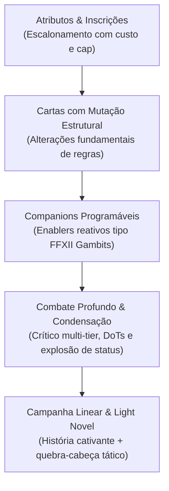
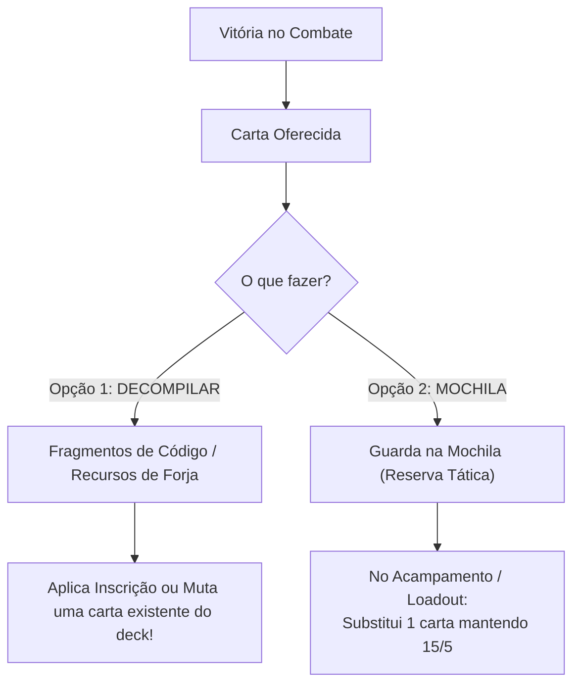

# 📜 Relatório de Direcionamento Estratégico & Game Design: HeroScript

**Projeto:** HeroScript / Protótipo de Combate  
**Data:** 30 de Outubro de 2026 (Atualizado)  
**Documento:** Síntese de Alinhamento de Produto e Design  

---

## 1. Visão Geral & Tese do Jogo

O **HeroScript** não será mais um clone de *Slay the Spire*. O projeto encontrou sua identidade no cruzamento entre a **profundidade matemática de um ARPG (*Path of Exile / Warframe*)**, a **fusão modular de baralhos (*Smash Up / Inscryption*)**, a **narrativa de progressão linear de uma Light Novel com RPG Tático (*Mega Man Battle Network / SteamWorld Quest*)** e a **automação reativa de companheiros (*Gambits de Final Fantasy XII*)**.

> **Pitch do Jogo (Steam):**  
> *"Um RPG tático de cartas com narrativa linear e estética de Light Novel, projetado para entusiastas de theorycrafting e customização profunda de sistemas. Em vez de depender do acaso de runs descartáveis, você acompanha a jornada de personagens marcantes enquanto projeta máquinas de combate sinérgicas: ajuste os atributos do seu herói por meio de inscrições de poder, altere a estrutura fundamental de suas cartas ao longo da jornada e programe o comportamento reativo de companheiros que atuam como facilitadores táticos.*  
> *O combate trata cada batalha como um quebra-cabeça tático. Se for derrotado, não há punição de recomeço: refine seu baralho de 15 cartas de herói e 5 de módulo, adapte sua estratégia com as cartas da mochila e tente novamente até superar o desafio."*

---

## 2. Os 4 Pilares Centrais



1. **Escalonamento por Atributos do Herói:** Cartas não têm números engessados; elas herdam multiplicadores a partir de atributos configurados com Inscrições que possuem custo e limite máximo (*cap*).
2. **Mutação Estrutural de Cartas:** Cartas podem ser alteradas em sua essência ao longo da campanha, mudando comportamentos, custos e tipos de dano.
3. **Companions Programáveis como Enablers:** Os companheiros não causam dano alto e não jogam sozinhos. Eles preparam o terreno (ex: o Elemental da Água molha os inimigos) e atuam como parceiros de diálogo e lore.
4. **Combate Visceral e Condensação:** Mecânicas de acerto crítico em camadas (*multi-tier* estilo Warframe) e capacidade de "condensar" dezenas de acúmulos de status contínuo (DoT) em um único impacto catastrófico.

---

## 3. As Grandes Viradas de Design (Pivots Desta Sessão)

### A. Fuga da Saturação: Campanha Linear de Personagem com Light Novel
* **O Problema:** O mercado de roguelikes tradicionais está saturadíssimo com milhares de clones de StS onde o jogador morre, perde tudo e anda num mapa de árvore procedural sem apego aos personagens.
* **A Decisão:** Adotar uma **Campanha Linear por Personagem com narrativa forte no estilo Light Novel / Visual Novel**:
  * Cada herói possui seu próprio arco dramático, rivalidades e diálogos ilustrados.
  * O jogador nunca perde o progresso da campanha ao morrer: **"Perdeu a batalha? Sem punição. Abre o Loadout, ajusta o deck e tenta de novo!"**
  * O combate atua como um **quebra-cabeça tático (Tactical Puzzle)**: ao enfrentar um chefe, o jogador aprende os padrões do inimigo e personaliza seu baralho para vencer.
  * **O Modo Roguelike:** Fica preservado como um modo arcade/fenda infinita opcional para o endgame, sem comprometer a integridade da história.

### B. Baralhos Modulares com Físicas Assimétricas (A Ideia "Smash Up")
Em vez de todos os baralhos gastarem a mesma "Mana", cada pacote de cartas introduz uma **física de recurso própria**:

| Módulo de Baralho | Filosofia Mecânica | Comportamento do Recurso |
|---|---|---|
| **Baralho Ardente** | O Termostato (*Threshold*) | **Não gasta**. As cartas geram Calor; quanto maior o Calor, mais brutais os bônus passivos das cartas. Decai com o tempo. |
| **Baralho Arcano** | A Bateria (*Pool*) | Clássico. Cristais de Mana fixos que recarregam a cada turno para comprar cartas e barreiras. |
| **Baralho do Caos / Void** | O Tributo da Mão (*Hand Sacrifice*) | **Sem números**. Custa cartas banidas diretamente da **mão** para a zona de `Banimento`. |
| **Baralho Necromântico** | A Ceifa do Descarte (*Graveyard Banish*) | Custa banir cartas do **Cemitério / Descarte** para alimentar rituais de morte. |
| **Baralho Volátil / Cinético** | O Ímpeto (*Fleeting*) | Cartas gratuitas ou super-fortes, mas com **prazo de validade**: todas são descartadas/destruídas no fim do turno. |

### C. Gestão de Mão: A Bancada de Ferramentas
* **Regra Padrão da Mesa:** **Retenção de mão + compra cadenciada.** O jogador começa com 4 a 5 cartas e compra 2 a 3 por turno, **mantendo o que sobrou** na mão (até um limite máximo de 8 a 10).
* **Por que isso salva o jogo:** Permite guardar a carta do combo para a rodada em que o Calor estiver em 100% ou esperar a carta do Caos para queimar o combustível certo. O descarte deixa de ser punição aleatória e vira uma mecânica controlada.

---

## 4. O Loop da Campanha Linear (A Experiência do Jogador)

```text
┌────────────────────────────────────────────────────────────────────────┐
│                        O LOOP DA CAMPANHA LINEAR                       │
│                                                                        │
│   [ 1. CAPÍTULO DA LIGHT NOVEL ] ── Diálogos ilustrados com o          │
│                                     Companion e personagens do mundo.  │
│                                                                        │
│                               ▼                                        │
│                                                                        │
│   [ 2. A BATALHA TÁTICA ] ──────── Duelo com o deck ativo (15+5).      │
│                                                                        │
│                ┌──────────────┴──────────────┐                         │
│                ▼                             ▼                         │
│         [ VENCEU A LUTA ]             [ PERDEU A LUTA ]                │
│         • Recompensa:                 • Sem frustração de recomeço!    │
│           Decompilar ou Mochila       • Abre a tela de Loadout.        │
│         • A história avança para o    • Adapta as cartas e Tenta       │
│           próximo encontro da LN!       Novamente até vencer o puzzle! │
└────────────────────────────────────────────────────────────────────────┘
```

* **Inspirações Mestres:** *Mega Man Battle Network*, *SteamWorld Quest: Hand of Gilgamech*, *Yu-Gi-Oh! (RPGs clássicos)*, *Card City Nights*.
* **O Companion como Personagem:** O Elemental da Água não é apenas uma passiva de combate; ele conversa com o Piromaníaco nos diálogos da Light Novel, reage com falas rápidas de combate (*barks*) e comenta o crescimento do herói.

---

## 5. Arquitetura de Baralho (15 + 5) & O Loop de Decompilação / Mochila

### A. A Composição do Baralho Ativo (Cravado em 20 Cartas)
O baralho de combate é gerado a partir de dois blocos complementares que são **embaralhados juntos na mesma pilha de compra** com **reciclagem contínua** (draw pile -> mão -> descarte -> reembaralha):

```text
┌────────────────────────────────────────────────────────────────────────┐
│                   COMPOSIÇÃO DO BARALHO (20 CARTAS)                    │
│                                                                        │
│   BARALHO PRINCIPAL DO HERÓI (15)        MÓDULO SECUNDÁRIO (5)         │
│   ├──────────────────────────────┤       ├─────────────────────────┤   │
│   │ • Fixo pelo Personagem       │       │ • Flexível / Escolhido  │   │
│   │ • Define a física de recurso │       │ • Define a mecânica de  │   │
│   │   primária (ex: Calor)       │       │   manipulação de zonas  │   │
│   │ • Ataques e defesas-base     │       │ • Cartas de impacto     │   │
│   └──────────────────────────────┘       └─────────────────────────┘   │
└────────────────────────────────────────────────────────────────────────┘
```

1. **Baralho Principal (15 cartas):** Amarrado ao Personagem escolhido. Dita a sua energia personalizada (ex: o Piromaníaco traz 15 cartas que usam e geram Calor).
2. **Baralho Secundário (5 cartas):** Flexível e modular. Dita a mecânica secundária de zonas:
   * **Módulo Void (Vazio):** Custa banir cartas diretamente da **Mão** para gerar efeitos avassaladores imediatos.
   * **Módulo Necromântico:** Custa banir cartas do **Cemitério / Descarte** para alimentar rituais de morte.
3. **Sem Deck Bloat:** O baralho ativo no combate permanece sempre com **20 cartas fixas**, garantindo que a reciclagem ocorra com precisão a cada 4 turnos.

---

### B. O Loop de Recompensas na Campanha: "Decompilar" vs. "Mochila"
Ao vencer um combate ou marco de capítulo, **a carta ganha nunca entra diretamente no baralho ativo**. O jogador é colocado diante de uma decisão deliberada:



1. **Opção 1: Decompilar (Desmontar a Carta):**
   * Transforma a carta ganha em recursos/materiais de forja.
   * Esses recursos são usados para **modificar cartas existentes** (adicionar Inscrições de atributos, alterar custos, adicionar palavras-chave como *Condensação* ou *Crítico Multi-tier*).
   * **Resultado:** O baralho não incha; ele fica mais denso, letal e especializado.
2. **Opção 2: Guardar na Mochila (Reserva Tática):**
   * A carta vai para a Mochila do herói.
   * Fora de combate (na tela de Descanso, Mapa ou Loadout), o jogador pode abrir a mochila e **substituir uma carta do deck ativo**, respeitando a proporção de 15 cartas de Herói e 5 cartas de Módulo.
   * Permite que o jogador adapte sua estratégia antes de enfrentar um chefe com fraquezas ou resistências específicas.

---

## 6. Arquitetura da Interface de Combate & Identidade Visual

### A. Filosofia: Combate entre Entidades Vivas (Anti-TCG)
* **Sem permanentes na mesa:** Não existem cartas de "criaturas/tropas" paradas no campo de batalha. O jogo é um duelo dinâmico e direto entre duas entidades.
* **Cartas como Técnicas/Descargas:** As cartas representam impulsos neurais, golpes marciais e reações elementais. Elas são jogadas a partir da mão, executam seu impacto visual no alvo e vão direto para a pilha de descarte ou para o banimento.

### B. Divisão Espacial da Tela (65% / 35%)

```text
┌────────────────────────────────────────────────────────────────────────┐
│                        [ ARENA DE DUELO (65%) ]                        │
│                                                                        │
│   [HERÓI: PIROMANÍACO]                                 [INIMIGO: GOLEM]│
│   • Pele cinza, fissuras de magma e incandescência     • Sprite rochoso│
│   • Barra de Vida + Escudo                             • Vida + Escudo │
│   • Termômetro de Calor (0-100)                        • Status Badges │
│                                                          (Chamas/Wet)  │
│   [COMPANION: ELEMENTAL DA ÁGUA]                                       │
│   • Widget de cadência (3 gotas d'água)                                │
│                                                                        │
├────────────────────────────────────────────────────────────────────────┤
│                     [ BANDEJA DE COMANDO (35%) ]                       │
│                                                                        │
│  [Baralho]          [ CARTA 1 ]  [ CARTA 2 ]  [ CARTA 3 ]   [Descarte] │
│                     (Mão retida com até 8 cartas)          [BANIMENTO] │
│                                                                        │
│                                                   [ ENCERRAR TURNO ]   │
│                                                   [ (15 Herói + 5 Mod)]│
└────────────────────────────────────────────────────────────────────────┘
```

### C. Conceito Visual de Referência


*(Mockup visual 16:9 ilustrando o duelo do Piromaníaco e Elemental contra o Golem de Pedra, com o termômetro de Calor e a bandeja de cartas com o portal de Banimento).*

---

## 7. Filosofia de Produção e Estratégia Comercial

```
[Fase 1: Vertical Slice]  -> 1 Herói (Piromaníaco) + 1 Companion (Elemental) + 2 Módulos
[Fase 2: Fechamento Core] -> Validação do "Game Juice", ritmo e legibilidade na Godot
[Fase 3: Contratação Arte] -> Com o jogo divertido e pronto, contrata-se arte e áudio sob medida
[Fase 4: Lançamento]       -> Modelo Mindustry (Código Aberto + Steam a R$ 25 / US$ 10 com Workshop)
```

1. **A Regra de Ouro da Arte:** Não gastar tempo nem dinheiro com ilustrações agora. O jogo deve ser construído primeiro com "programmer art", ícones vetoriais limpos e excelente tipografia/layout. Uma gameplay comprovadamente viciante atrai artistas parceiros e evita desperdício financeiro.
2. **O Modelo "Mindustry":**
   * Engine e jogo com código aberto (GPLv3 / MIT), atraindo a comunidade de programadores e modders;
   * Versão oficial compilada vendida na Steam por um valor acessível (R$ 20 a R$ 25 / US$ 7.99 a 9.99);
   * Monetização via **conveniência**: suporte a Steam Cloud, conquistas e integração nativa com o **Steam Workshop** (que a sua engine data-driven em JSON atende perfeitamente).
3. **Alavanca de Portfólio:** O projeto consolidado serve como prova cabal de habilidades de engenharia de nível *Staff / Systems Engineer*.

---

## 8. O Experimento Mínimo Imediato (Action Items Atualizados)

* [ ] **Criar o Setting Mínimo na Engine (`data/configs/prototype-test`):**
  * **15 Cartas do Piromaníaco (Herói):** Geram e escalam com Calor (Termostato).
  * **5 Cartas do Void (Módulo Secundário):** Custam banir cartas da própria mão.
  * **1 Companion:** Elemental da Água aplicando `Molhado` em cadência de 3 turnos.
* [ ] **Fluxo de Mão e Ciclo:**
  * Baralho de 20 cartas unificadas na compra, mão retida, reciclagem por descarte.
* [ ] **Sistema de Recompensa e Retry Testável:**
  * Se perder o combate: botão **[Ajustar Baralho]** e **[Tentar Novamente]** sem recomeçar o jogo.
  * Se vencer: tela com opção de **Decompilar** (gerando material de Inscrição) ou **Guardar na Mochila**.
