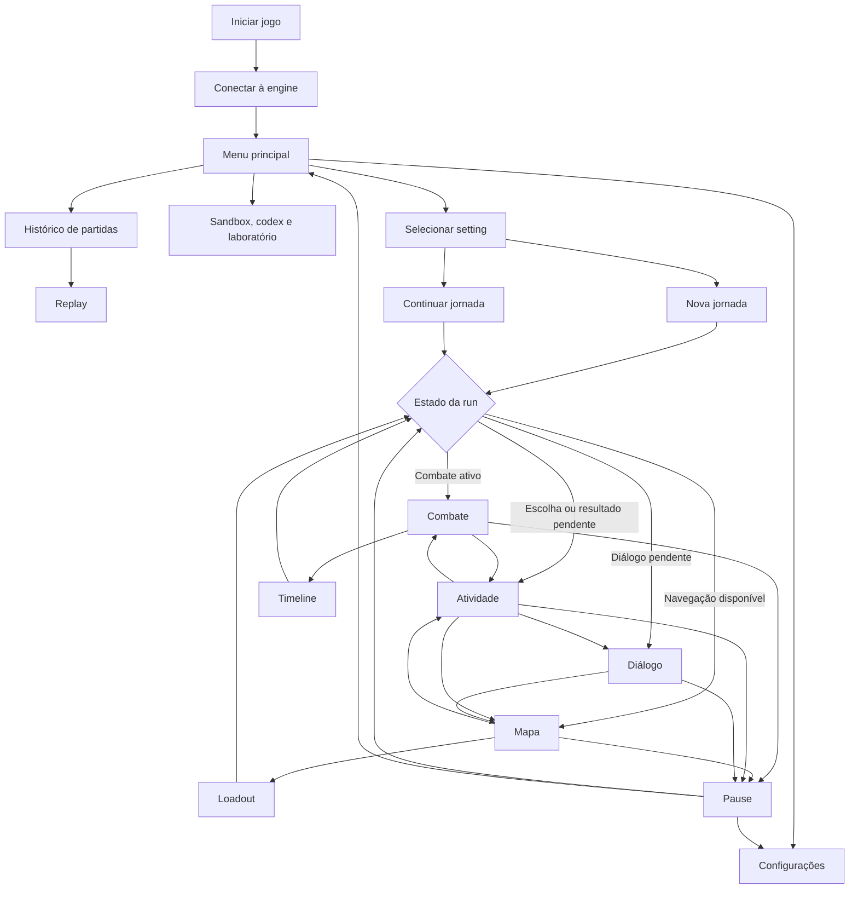

# Fluxo da interface Godot

Este documento mapeia a navegação da demonstração Godot a partir dos roteadores e componentes atuais. As opções efetivamente disponíveis dependem do setting, do estado da run e das capacidades publicadas pela API.

## Visão geral

As setas representam caminhos possíveis. A engine decide quais comandos são legais e qual atividade está disponível em cada momento.

## Entrada e menu principal

Ao iniciar, a Godot tenta conectar ao endereço configurado. Quando a configuração é elegível para inicialização local, também pode iniciar o servidor. O menu apresenta o progresso da conexão.

O menu oferece seleção de setting, nova jornada, continuação, histórico de partidas, sandbox, codex, configurações, laboratório de inscrições, reconexão e saída. A disponibilidade de ações varia com a conexão e a sessão.

Ao trocar de setting, a interface limpa a sessão ativa e procura a continuação associada à combinação de servidor, jogador, setting e modo. Uma nova jornada e uma continuação encaminham o estado recebido da API para o resolvedor de rotas.

## Resolução da tela da run

`open_game()` consulta o estado atual e aplica, nesta ordem, as regras de `GameplayRouteResolver.resolve_route`:

1. Sem run carregada, abre o menu.
2. Com combate ativo, abre o combate.
3. Com tentativa de encontro aguardando confirmação ou repetição, abre a atividade.
4. Com nó de diálogo ativo e não resolvido, abre o diálogo.
5. Com escolha detalhada disponível ou run encerrada, abre a atividade.
6. Nos demais casos, abre o mapa.

As escolhas detalhadas incluem recompensas de cartas, compras, preparação, upgrades, transformações, relíquias e ofertas de inscrições. Um retorno de tela consulta novamente o estado, inclusive ao continuar uma run.

## Mapa e atividades

No mapa, o jogador consulta os nós, seleciona um destino disponível e envia a escolha pela API. A interface abre a atividade correspondente ou o combate iniciado naquele nó. O mapa também dá acesso ao loadout da run.

As atividades podem apresentar recompensas de cartas, escolha ou decomposição, loja, relíquias, preparação, upgrades, transformações, ofertas de inscrições e início ou resultado de encontros. Ao concluir uma atividade, o estado atualizado determina o retorno ao mapa ou a próxima tela. A tela de resultado de run pode oferecer acesso ao replay.

O fluxo detalhado do mapa está em [Map navigation implementation](MAP_NAVIGATION_IMPLEMENTATION.md).

## Combate

A tela mostra atores, recursos, status, intenções inimigas e mão. A interação com uma carta segue o estado e as opções publicados pela engine:

1. O jogador seleciona ou arrasta uma carta.
2. Escolhe alvo, alternativa de custo ou cartas de pagamento quando necessário.
3. A interface apresenta os dados e prévias retornados pela API.
4. O comando é enviado à engine.
5. A Godot reproduz os eventos de apresentação e atualiza o estado confirmado.

O jogador pode inspecionar as pilhas de compra, descarte e exílio, consultar informações do personagem, abrir a timeline e encerrar o turno. Depois do combate, o estado da run determina a tela de resultado ou atividade seguinte.

## Timeline e replay

A timeline é acessível durante o combate e apresenta eventos e estados disponíveis. Navegação histórica, retorno e operações com branches dependem das capacidades publicadas pelo modo. O retorno à run usa o roteador do estado atual.

O replay da run é uma tela separada, acessível pelo histórico e por pontos do fluxo da jornada. Ela permite selecionar e percorrer registros e inspecionar os dados disponíveis. O retorno depende da origem da abertura, como histórico ou jornada.

## Diálogo

Um nó de diálogo abre sua própria cena. O jogador lê, avança e seleciona opções quando oferecidas. A Godot envia a escolha à API. Após conclusão e resolução, o roteador abre o mapa ou outra tela determinada pelo estado.

O histórico de conversas pode ser aberto pelo pause quando houver entradas disponíveis.

## Loadout da run

O loadout unificado possui subguias de visão geral e atributos, inscrições, baralho e seus módulos ou compartimentos, relíquias e companions. A disponibilidade de cada módulo depende do conteúdo e das capacidades da run.

As alterações editáveis seguem os serviços da engine e o fluxo de salvamento automático. Ao sair, o roteador retorna à tela apropriada ao estado da run. O laboratório de inscrições acessado pelo menu é uma tela separada do loadout da run.

## Pause e configurações

O pause é uma sobreposição disponível nas telas de combate, mapa, atividade e diálogo. Ele permite retomar, abrir configurações, voltar ao menu e, quando autorizado, confirmar o abandono da run. Também apresenta acesso ao histórico de conversas quando houver conteúdo.

As configurações possuem as categorias General, Audio, Display, Accessibility, Controls e Connection. Quando abertas a partir da run, retornam ao contexto de jogo. Quando abertas pelo menu principal, retornam ao menu.

## Histórico e ferramentas

O histórico apresenta partidas e permite abrir seus replays. Sandbox, codex e laboratório de inscrições são acessados pelo menu principal e têm navegação própria. Os recursos expostos por ferramentas variam conforme o setting e o perfil de acesso.

## Responsabilidades e referências

A Godot organiza telas, coleta entrada e apresenta estados e eventos recebidos pela API. A engine é a autoridade para regras, estado, comandos legais, conteúdo e capacidades. A interface não deve inferir a conclusão de uma atividade apenas pela apresentação.

- [Roteador principal](../../examples/godot-engine-showcase/scripts/ui/main.gd)
- [Resolvedor de rotas da run](../../examples/godot-engine-showcase/scripts/ui/gameplay_route_resolver.gd)
- [Registro de cenas](../../examples/godot-engine-showcase/scripts/ui/scene_registry.gd)
- [Sessão e comunicação com a engine](../../examples/godot-engine-showcase/scripts/application/game_session.gd)
- [Tela de combate](../../examples/godot-engine-showcase/scripts/ui/combat_screen.gd)
- [Tela do mapa](../../examples/godot-engine-showcase/scripts/ui/map_screen.gd)
- [Tela de atividade](../../examples/godot-engine-showcase/scripts/ui/activity_screen.gd)
- [Loadout unificado](../../examples/godot-engine-showcase/scripts/ui/unified_loadout_screen.gd)
- [Configurações](../../examples/godot-engine-showcase/scripts/ui/settings_screen.gd)

Este mapeamento foi produzido pela leitura do código. Ele não certifica visualmente todas as transições nem garante que todos os módulos estejam habilitados em todos os settings.
