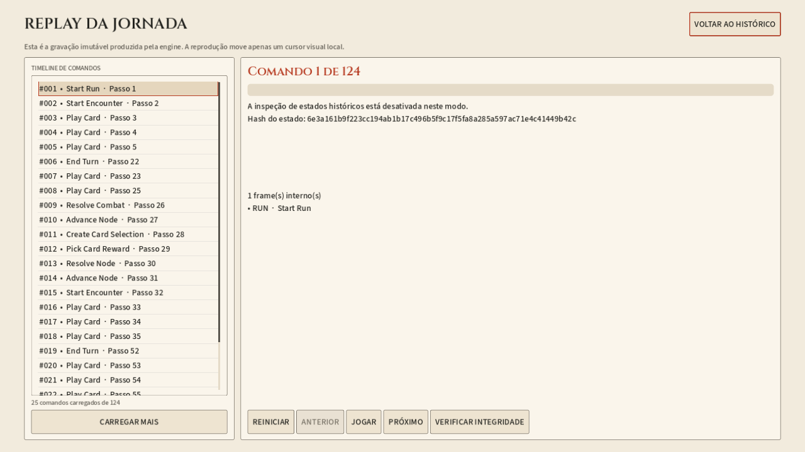
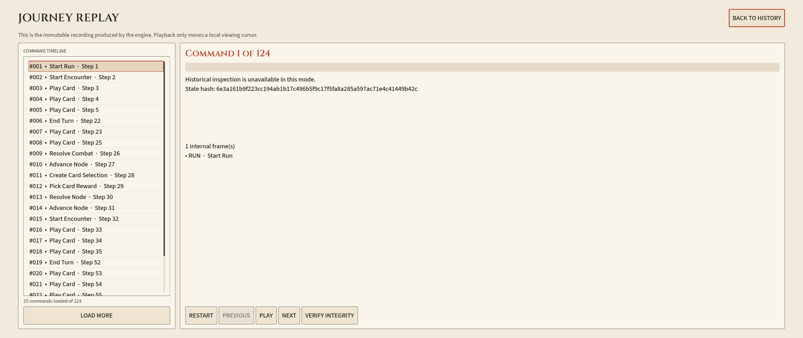

# Replay: entrega e certificação

Data: 2026-10-13. Guia:
[plano de implementação](../plans/REPLAY_LOADING_ARCHITECTURE_AND_PERFORMANCE_PLAN.md).

## Resultado

- Timeline canônica compacta, paginada por envelopes, com head fixo,
  hasMore explícito, escopo e permissão efetiva de inspeção.
- Apresentação individual de comando com resumo e transcrição registrada.
  Estado completo continua disponível somente na inspeção técnica autorizada.
- Godot separada em controller, presenter, view e adapter.
- Primeira página de 25 comandos visível sem baixar o restante. Next/autoplay e
  Load More atravessam páginas sem limite silencioso de 4.000 comandos.
- Tickets canceláveis, epoch de endpoint, coalescência e LRU de até 32
  apresentações/8 MiB de JSON aproximado; não corresponde à memória residente.
- Segmentos de estado capturados uma vez e processados fora do gate em leituras
  públicas. Validação de bytes, estados, hashes e cadeia permanece.
- Metadados de tipos JSON preparados antes da API ficar pronta. Não há
  pré-carregamento de runs, resultados de hash ou execução de comandos no warmup.
- RNG, regras, política de checkpoints e schema de persistência não mudaram.

## Medição

Windows local, .NET 10.0.9/Release, 12 processadores lógicos e Godot
4.7.2 Steam. Dados de teste e preferências isolados. API em 5294, perfil normal,
uma cópia da run de 124 comandos e seu conteúdo publicado.

| Operação | Antes | Depois |
| --- | --- | --- |
| Timeline inteira: leitura/serialização local, primeira leitura de processo | 6,19 s | Deixou de ser requisito para abrir |
| JSON da timeline inteira | 8.047.708 bytes | Primeira página compacta: 23.506 bytes no benchmark |
| Timeline compacta de 25 itens, instância nova do store com cache 256 | — | 60,53 ms no benchmark |
| Mesma consulta aquecida | — | 34,89–44,91 ms |
| Primeiro conteúdo desenhado, API recém-iniciada, medição nativa final | Não medido antes na UI | 903 ms |
| Cinco aberturas nativas seguintes, EN/PT e três resoluções | — | 225–309 ms |

Benchmark local não inclui HTTP/Godot. A medição nativa inclui aplicação de
modelo, um frame de layout e espera por frame_post_draw antes de registrar o
tempo. Não confundir ganho de payload por paginação com compressão de todo o
histórico: o conteúdo completo continua consultável.

A amostra nativa é pequena: uma abertura fria de processo e cinco aquecidas.
Não prova p95 frio universal nem latência idêntica em outra máquina. OS/disco
podem estar aquecidos. Antes do warmup de metadados, houve uma abertura nativa
de 1.116 ms, preservada como comparação; não foi descartada como aprovação.

Fixtures de armazenamento: 25/125/500/1.000/4.001 comandos, com payload de
16 KiB por frame e estado. Na fixture de 4.001, a primeira página compacta
teve 12.278 bytes e aproximadamente 9–15 ms em leituras aquecidas, sem
cache de validação. São fixtures de storage, não partidas semanticamente válidas.

## Testes

- Core completo: 1.668 testes aprovados na revisão final.
- API: 208 testes sem a jornada longa + 1 jornada do ato completo aprovados.
  A tentativa inicial integral atingiu o timeout de cinco minutos após 207
  sucessos; foi repetida com orçamento ampliado e a jornada longa separada.
- Após warmup: 13 testes direcionados de API/contrato/permissão/replay aprovados.
- Godot: transporte 5, paginação/cache 13, recuperação/configurações 64 e
  arquitetura passiva 28 checks aprovados; camadas, pausa e diálogo também
  verificados durante a implementação.
- Suíte offline padrão completa também aprovada na revisão final.
- Online/nativo: 46 checks aprovados, três settings, modo com inspeção,
  modo normal restrito, resumo, cache, travessia de páginas e hashes semânticos
  das novas runs de QA inalterados.
- Navegação de 4.001 comandos verificada sem consulta vazia final.
- Append/delete/cancelamento e corrupção de fronteira/bytes cobertos no store.

Nenhum save pessoal foi alterado. A run longa foi copiada para QA, não ativada
na sessão de gameplay. Novas runs de certificação usam players de QA exclusivos.

## Permissões e limites

Campanhas cuja policy desativa inspeção histórica mostram cabeçalhos e hash,
não um resumo de estado inventado. A timeline publica a permissão efetiva para
evitar um pedido previsivelmente negado. Um GET de inspeção continua protegido
pela API, independentemente de botão ou cache.

Verify segue separado e potencialmente caro: reexecuta comandos em runtime
isolado. Capturas e primeiras páginas não são prova substituta desse processo.
Não foram acrescentados prefetch especulativo, cache compartilhado de estados,
índice permanente de checkpoints ou mudança de formato dos saves.

## Reprodução

- `tools/ReplayReadBenchmark`: comparação de leitura/payload, sem reparar índices.
- `tools/test-godot-ui.ps1 -Tests replay_progressive,replay_transport,settings_recovery,run_graphics_architecture`.
- Online: `-Tests replay_online -ApiUrl <API QA>`; requer a cópia da run longa
  usada no fixture e conteúdo compatível. Não apontar para a API das partidas.
- Nativo: `-VisualTest replay_online -VisualOutputDirectory <diretório> -ApiUrl <API QA>`.

Capturas finais de exemplo:

