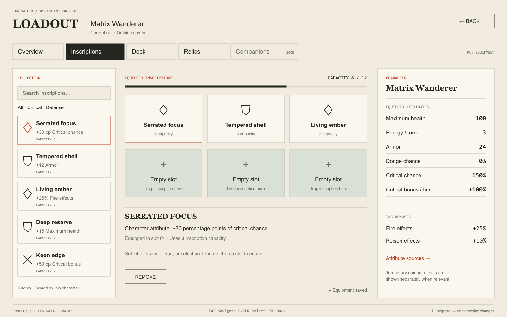
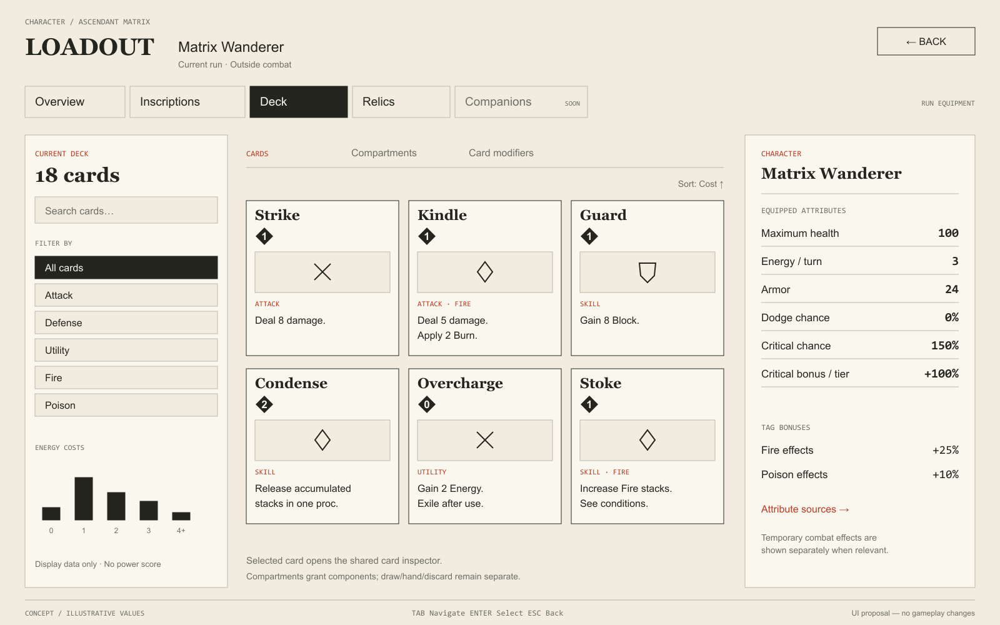

# Loadout unificado — pesquisa, conceito e viabilidade

Data: 27/10/2026. Escopo: **proposta de experiência e arquitetura de apresentação**, sem implementação das telas ou alteração de regras. Os mockups são estudos estáticos; nomes, números e quantidade de posições são ilustrativos.

Decisão do autor: **todas as guias editáveis salvam automaticamente cada alteração válida e completa**. Não haverá botão Aplicar/Salvar, rascunho manual pendente nem confirmação de salvamento ao trocar de guia. Guias exclusivamente de inspeção não enviam comandos ao navegar.

## 1. Recomendação

Criar uma página **Loadout**, vinculada ao personagem atual da run, com subguias **Visão geral / Inscrições / Baralho / Relíquias / Companions**. Manter identidade, navegação e atributos no mesmo lugar; substituir apenas a área de trabalho da guia.

A unificação é da navegação e da leitura da build. Inscrições, cartas, compartimentos, modificadores e relíquias continuam sistemas independentes. Companions aparecem como planejamento identificado no protótipo, sem inventário fictício nem botões de equipamento funcionais. Em uma versão publicada, módulos não oferecidos pelo setting podem simplesmente não aparecer.

O resultado deve ajudar o jogador a responder:

1. O que meu personagem tem equipado?
2. Como seus atributos afetam minhas cartas?
3. O que esta peça ou alteração muda?
4. Posso fazer essa alteração neste momento?

Não transformar a página em um painel de debug ou num catálogo de todas as funcionalidades da engine.

## 2. Pesquisa: o que aproveitar das referências

As fontes abaixo são publicações oficiais. As aplicações ao HeroScript são **recomendações próprias**, não requisitos ou afirmações de superioridade comprovada por esses jogos. As publicações têm datas diferentes; foram consultadas nesta revisão como exemplos de sistemas existentes.

| Referência | Evidência da fonte | Adaptação recomendada | Evitar copiar automaticamente |
|---|---|---|---|
| **Warframe — Mods** | Mods ocupam posições, têm Drain e respeitam uma capacidade total. O mesmo conceito atende diferentes equipamentos, incluindo companions. | Coleção separada dos encaixes; custo no item; orçamento agregado junto do quadro; vazio visualmente distinto. | Polaridades, fusão, cópia compartilhada ou regras de posse: são decisões próprias do jogo. |
| **Warframe — acesso pela navegação** | O Devstream 180 descreve alterar o loadout a partir da navegação para reduzir a necessidade de voltar ao Arsenal. | Um acesso à build a partir do mapa, retornando ao mesmo nó e posição da câmera. | Abrir uma cena diferente para cada pequeno ajuste ou mudar a regra de edição durante o combate. |
| **Guild Wars 2 — Hero panel/templates** | O painel do herói organiza combinações de traits/skills em Build e equipamento em Equipment; a biblioteca de builds tem função distinta. | Um contexto de personagem compartilhado com módulos separados; inventário, equipamento e modelos não são sinônimos. | Chamar a guia ativa de “preset”, ou assumir que todos os sistemas precisam de um inventário único. |
| **Diablo IV — Armory** | A Armory apresenta e salva conjuntos de equipamento, skills, Paragon e mecânica de classe; loadouts são associados ao personagem. | Visão geral que resume a build inteira e deixa claro o dono. Modelos completos podem ser uma evolução posterior. | Prometer “salvar build inteira” quando o backend só aplica transações independentes por módulo. |
| **Hearthstone — composição de deck** | O texto técnico do Smart Deck Builder considera distribuição de custos e composição, incluindo sinergias. | Contagem de cartas e distribuição de custos para ajudar a ler o deck; filtros por tags e comportamentos já descritos no conteúdo. | Auto-build, nota de poder, “DPS da build” ou recomendações calculadas sem respaldo nas regras. |
| **Xbox Accessibility Guidelines 112/113** | Recomendam navegação consistente, acesso alternativo a inventários complexos e foco visível e contido nos diálogos. | Teclado/controle completos, busca e filtros, foco restaurado por guia, inspeção acessível sem depender de hover. | Drag obrigatório, foco em elemento oculto ou mudança de layout que desoriente a navegação. |

Fontes:

- [Warframe — Mods Guide](https://www.warframe.com/en/news/mod-ja).
- [Warframe — Devstream 180 Overview, Loadout Customization From Navigation](https://www.warframe.com/en/news/devstream-180-overview).
- [Guild Wars 2 — Build and Equipment Templates Are Live](https://www.guildwars2.com/en/news/build-and-equipment-templates-are-live/).
- [Diablo IV — Master the Occult in Season of Witchcraft, seção The Armory](https://news.blizzard.com/en-us/article/24167111/master-the-occult-in-season-of-witchcraft).
- [Hearthstone — Developer Insights: Smart Deck Builder](https://news.blizzard.com/en-us/article/22938500/developer-insights-smart-deck-builder).
- [Xbox — UI navigation](https://learn.microsoft.com/en-us/xbox/accessibility/xbox-accessibility-guidelines/112) e [UI focus handling](https://learn.microsoft.com/en-us/xbox/accessibility/xbox-accessibility-guidelines/113).

## 3. Diagnóstico do projeto atual

| Área | Estado conferido | Implicação para o conceito |
|---|---|---|
| Inscrições na run | `run_loadout_screen.gd` fixa contexto em run/personagem/setting, usa workspace e view passiva; edição chama preview, comando e releitura automaticamente. | Pode virar um módulo da página; não precisa de outra regra de equipamento. |
| View de inscrições | `loadout_view.gd` apresenta coleção, encaixes, busca, detalhes e atributos. Também atende laboratório. | Extrair/recompor áreas reutilizáveis, evitando duplicar o painel global de atributos. |
| Atributos | `character_attributes_view.gd` apresenta projeções; a API de loadout fornece atributos e before/after do preview. | Reutilizar a apresentação e os valores autoritativos; não somar bônus na Godot. |
| Compartimentos | `run_deck_compartments.gd` usa editor/workspace próprios; há leitura, preview e `APPLY_DECK_COMPARTMENTS`. Atualmente há confirmação Apply explícita. | Colocar dentro de Baralho e substituir Apply pelo fluxo automático após cada realocação completa, preservando validação e transação canônicas. |
| Cartas | Há CardView e presenters compartilhados; compartimentos já consomem a apresentação composta. | Usar a carta real na grade e na inspeção, com seus efeitos e condições; não criar uma versão resumida sem informação de gameplay. |
| Relíquias | Há estado e leitura canônica em `GET /api/v1/runs/{runId}/relics`. | Oferecer inspeção das relíquias obtidas. Não assumir possibilidade de equipar/desequipar livremente. |
| Companions | O kind `companions` está registrado como `JsonElement`, sem contrato tipado de loadout de companions encontrado. Atores aliados genéricos não equivalem a esse sistema. | Seção futura, sem afirmar suporte a recrutamento, equipamento, progressão ou troca de companheiro. |
| Navegação | Rotas separadas para inscrições e compartimentos em `main.gd`; atividades encaminham cada uma. | Consolidar entradas em Loadout e permitir abrir diretamente uma guia pelo contexto. |
| Laboratórios | Cenas e adapters de teste existem separadamente. | Permanecer separados; não introduzir amostras offline ou seletor de personagem dentro da run. |

Fontes locais principais: [tela da run](../../examples/godot-engine-showcase/scripts/ui/run_loadout_screen.gd), [view de inscrições](../../examples/godot-engine-showcase/scripts/ui/loadout/loadout_view.gd), [editor de compartimentos](../../examples/godot-engine-showcase/scripts/ui/deck_compartment_editor.gd), [API de loadout](../api/inscription-loadouts.md), [API de compartimentos](../api/deck-compartments.md) e [registro de conteúdo](../../src/Core/Content/ContentKindRegistry.cs).

Um detalhe a resolver na integração: hoje `Clear draft`, na tela de inscrições da run, pode esvaziar atribuições e salvá-las automaticamente. Como não haverá rascunho manual, a ação deve se chamar **Desequipar tudo** ou **Limpar distribuição**, conforme o módulo. Limpezas em massa devem informar a consequência e pedir confirmação da ação; sua gravação depois ocorre automaticamente. Isso não introduz confirmação de salvamento nas edições comuns.

## 4. Estrutura da página

```text
LOADOUT       Personagem atual · Setting · Situação da run          Voltar
───────────────────────────────────────────────────────────────────────
Visão geral | Inscrições | Baralho | Relíquias | Companions [Planejado]
───────────────────────────────────────────────────────────────────────
Coleção / filtros      Quadro / cartas / seleção         Atributos
da guia ativa         da guia ativa                     do personagem
                      + detalhes da seleção             sempre presentes
───────────────────────────────────────────────────────────────────────
Ajuda de interação                  Estado de salvamento / erro útil
```

### Moldura persistente

- Cabeçalho compacto: personagem atual, setting e contexto. Sem seletor de personagem na run; sem trocar de setting a partir desta tela.
- Guias textuais com ícones simples opcionais. O ícone complementa o nome; não exige adivinhar o significado.
- Região central variável e painel de atributos estável à direita. A seleção de um item não substitui os atributos por uma segunda ficha de detalhes.
- Estado curto: “Salvo”, “Validando…”, “Salvando…” ou erro com ação de recuperação. Não manter um estado normal de rascunho aguardando Aplicar. Nada de IDs, fingerprints ou revisão de conteúdo no fluxo normal.
- Voltar preserva mapa/atividade, câmera e seleção relevante. Trocar guia não remonta a run nem avança tempo de gameplay.

### Proporção inicial para validar

No desktop, usar aproximadamente **22% para coleção/filtros, 52% para trabalho e 26% para atributos**, descontando margens e separações. São metas de composição, não percentuais rígidos para qualquer resolução.

Em 1280×720, a coluna de atributos vira uma gaveta sobreposta acionada por “Atributos”; os controles de edição permanecem legíveis. Em 1920×1080, três colunas. Em 2560×1080, ampliar a área útil da coleção/grade com limite de largura de leitura, mantendo os atributos ancorados à direita. Não esticar cartas nem símbolos para preencher o monitor.

Em todas as resoluções: rolagem vertical por região, sem rolagem horizontal obrigatória; busca/foco e cabeçalho estáveis; texto aumentado deve provocar reorganização controlada, não fonte minúscula automática em toda a página. Os breakpoints dependem da largura mínima real dos componentes e da escala de texto.

## 5. Conteúdo das subguias

### Visão geral — a build em uma leitura

Mostrar miniaturas e resumos navegáveis: inscrições instaladas/capacidade, tamanho e composição do deck, compartimentos quando habilitados e relíquias ativas. Cada resumo abre sua guia. Atributos continuam à direita.

Explicar contribuições concretas: “Chance crítica: 150%” ou “3 cartas recebem componentes deste compartimento”. Não inferir uma build “de fogo” ou classificar sua força apenas pela contagem de tags. Efeitos situacionais e relíquias com contrapartidas precisam ser descritos com suas condições.

Não criar uma grande vitrine de personagem ou um dashboard de gráficos. A visão geral serve como orientação; reabrir Loadout pode restaurar a última guia usada naquele contexto, enquanto um atalho contextual abre diretamente a guia desejada.

### Inscrições — atributos do personagem

- Esquerda: coleção acessível, busca, filtros por tags/atributos e ordenação. Inventário Actor ou Run vem da política; isso não altera o dono do equipamento atual.
- Centro: encaixes e capacidade conforme o JSON. Vazio usa preenchimento diferente, símbolo `+` e texto. Ocupado mostra identidade, custo e estado equipado.
- Inspeção: descrição “+X ao atributo do personagem”, contrapartidas e custo. Selecionar apenas inspeciona; arrastar ou selecionar item + destino solicita alteração.
- Direita: valores equipados; um preview válido de substituição apresenta diferença explicitamente marcada, sem somá-la aos valores salvos.
- Sem botões Refresh run, Preview draft ou ferramentas de debug. Preservar o salvamento automático existente.

### Baralho — cartas, componentes e distribuição da build

Subnavegação local: **Cartas / Compartimentos / Modificadores de cartas**. As duas últimas aparecem somente quando houver suporte/conteúdo apropriado no contexto.

**Cartas:** grade do baralho persistente do personagem, usando o componente visual do combate. Filtros por custo, tags, comportamento e alterações; ordenação clara. Mostrar base e contribuições conforme o contrato de apresentação, sem introduzir nomes de alvos de um combate inexistente. Estatísticas de composição são dados de leitura, não uma simulação de combate.

Contar as instâncias canônicas sem duplicar a mesma carta por sua presença em projeções de zonas. “Baralho atual” não deve virar sinônimo de “mão”, nem revelar ordem oculta do monte. A curva de custos usa os resources realmente cobrados; com vários resources, oferecer distribuição por resource em vez de somá-los como se fossem equivalentes.

**Compartimentos:** reaproveitar o editor atual. Apresentar capacidades e componentes concedidos, não fixar papéis fogo/veneno/cura no código. Não misturar compartimentos da build com draw, hand, discard ou exile. Mostrar o efeito composto e sua origem ao inspecionar uma carta.

**Modificadores de cartas:** inventário próprio e seleção de carta elegível, com efeito do item explicado antes de aplicar. Upgrades permanentes, modifiers temporários e componentes de compartimento recebem proveniências distintas. A existência da guia não libera aplicação fora das janelas/atividades autorizadas.

Não incluir botão universal de adicionar/remover cartas: aquisição, remoção e crafting continuam nos fluxos de gameplay existentes, a menos que o modo explicitamente exponha essas ações.

### Relíquias — mudanças de regra

Coleção de relíquias obtidas, efeito completo, condições de ativação, custos/contrapartidas e explicação das palavras-chave. A identidade visual pode ser um selo ou peça distinta das inscrições.

São regras excepcionais da build, não “mods mais fortes”. Não impor slots, orçamento de inscrições ou drag-to-equip a um sistema que hoje pode representar aquisição permanente na run. A guia inicialmente é de inspeção; uma ação só aparece quando a engine a oferecer.

### Companions — lugar reservado, sem regra inventada

No protótipo, guia com etiqueta **Planejado** e página explicativa: “Sistema ainda não implementado”. Não mostrar um cadeado de progressão, um slot obrigatório ou estatísticas de um companion imaginário como se fossem reais.

O desenho futuro pode usar coleção à esquerda, companheiro selecionado no centro e contribuição ao personagem/equipe na direita. Quantidade, posse, troca, persistência e ações precisam de design e contratos próprios antes de haver equipamento funcional. Companions não serão tratados como inscrições nem como cartas apenas para reutilizar uma grade.

## 6. Atributos e inspeção

O painel direito é a referência estável da build. Mostrar os atributos presentes no setting, com nomes e unidades de apresentação: vida máxima, energia pertinente à regra, armor, dodge, chance crítica, bônus crítico por tier e bônus de tags/canais configurados. Não hardcodar mana ou energia em todos os jogos.

- **Equipado:** valor canônico da build atual.
- **Prévia:** valor canônico retornado para uma alteração candidata; diferença em coluna reservada e identificada.
- **Efeitos temporários:** grupo separado quando aplicável; não confundir debuff de combate com equipamento permanente.
- **Origem:** inspeção expansível de base, inscrições, relíquias e demais contribuições que a API realmente informar.

Chance crítica e bônus crítico têm unidades distintas; percentual e ponto percentual não são intercambiáveis. Nenhuma redução por armor, rolagem, scaling ou bônus de tag é recalculado na Godot. Não exibir uma mitigação percentual universal se ela depender do pedido de cálculo/contexto.

Detalhes do item selecionado ficam abaixo do quadro ou em inspector fixável sobreposto, alcançável pelo teclado. Tooltips complementam palavras-chave; não são o único lugar onde se consegue ler a função do item. Hover, seleção e foco de teclado precisam ter estados distintos.

Na carta, preservar as diretrizes existentes: borda de raridade, valores-base em branco, redução em vermelho e aumento em azul onde o componente atual as utiliza. Nas listas de diferenças de atributo, acrescentar sinal e texto; não comunicar o resultado apenas por cor.

## 7. Edição e salvamento sem ambiguidade

Todas as guias seguem o mesmo modelo de salvamento automático. A unidade de gravação é uma intenção completa do jogador, nunca um fragmento intermediário do gesto:

| Módulo | Comportamento definido |
|---|---|
| Inscrições | Preservar preview interno + aplicação automática por operação completa, como hoje. |
| Compartimentos | Preview interno + aplicação automática de cada realocação, troca ou limpeza completa, pelo comando existente. Remover Apply. |
| Cartas/modificadores/relíquias | Inspeção não grava. Quando uma ação de edição estiver autorizada pela engine, concluir a ação dispara seu comando canônico automaticamente, sem um segundo botão Salvar. |
| Companions | Sem edição ou persistência enquanto não implementado. Quando houver equipamento funcional, deverá seguir o mesmo autosave. |
| Visão geral | Leitura dos estados confirmados; navegar pelos resumos não grava gameplay. |

Ao soltar uma peça ou concluir a alternativa por clique/teclado: montar a distribuição final candidata, validar pelo preview quando disponível, enviar o comando e atualizar a projeção confirmada. Uma troca de duas posições é uma única operação atômica, não dois comandos de remover/equipar. Começar um drag, passar o ponteiro, inspecionar, pesquisar ou filtrar não grava. Uma prévia visual precisa estar identificada até a confirmação da engine.

Não haverá Aplicar, Salvar tudo ou diálogo de aplicar/descartar ao trocar guia. O controller mantém operações em andamento mesmo se a view da guia mudar; o status de salvamento permanece na moldura. Voltar ao mapa deve aguardar a conclusão/recuperação de uma gravação pendente, sem descartá-la silenciosamente. Se não for possível confirmar, mostrar o erro e oferecer recuperação, sem anunciar que foi salvo.

Serializar as mutações da mesma run entre as guias, usando a versão confirmada mais recente para a próxima operação. Uma guia não pode publicar equipamento calculado sobre um snapshot anterior à gravação de outra. Preservar a atomicidade de cada comando; autosave não significa uma transação global que mistura inventários e módulos.

Durante uma gravação, preservar a disposição e a leitura; bloquear somente a edição incompatível. Não remontar todos os componentes nem resetar busca/rolagem ao receber a resposta. Erro não apaga equipamento confirmado; conflito de versão recarrega o estado autoritativo e explica o que não foi aplicado. Resposta incerta reutiliza o mesmo comando idempotente.

Em combate ou outra janela proibida, permitir inspeção onde houver projeção segura, com motivo legível para edição indisponível. A página não concede permissão que o modo não tenha.

## 8. Arquitetura de apresentação proposta

```text
UnifiedLoadoutScreen
  ├─ Header + ModuleTabs + Feedback
  ├─ ActiveModuleView (Overview / Inscriptions / Deck / Relics / Future)
  └─ CharacterAttributesPanel

LoadoutPageController
  ├─ contexto: run + personagem + setting + versão
  ├─ registro dos módulos e suas disponibilidades
  └─ presenters/workspaces/gateways existentes por domínio

REST → projeção canônica → presenter → view
intenção do jogador → workspace/serviço → preview/comando REST
```

- A view comum não equipa nada e não conhece fórmula de efeito, custo ou consequência de relíquia.
- O registro de módulos descreve disponibilidade, título, ícone, view e estado de edição. Não obriga a engine a adotar uma “superentidade loadout” que misture inventários.
- Reutilizar `loadout_view.gd`, `inscription_tile.gd`, `character_attributes_view.gd`, CardView e os workspaces; extrair cabeçalhos/painéis locais onde for necessário para evitar molduras duplicadas. Não apenas aninhar as cenas inteiras atuais com seus botões Voltar e scrolls concorrentes.
- A sessão/gateway continua cuidando da comunicação, versão e recuperação. O controller da página coordena navegação e apresentação, sem se tornar outro RunManager.
- Uma coordenação de gravação por run mantém a ordem das intenções entre guias e sobrevive à troca da view ativa. Rascunhos internos servem apenas ao preview automático e não viram uma etapa manual de Aplicar.
- Leituras independentes podem compartilhar cache por run/personagem/revisão/sequence/step. Se respostas chegarem de versões diferentes, não exibir uma build híbrida: descartar/reler o conjunto incompatível ou manter o último snapshot consistente.
- Carregar o conteúdo pesado da guia sob demanda; navegar entre guias não precisa refazer toda a leitura do inventário. Não adicionar polling por frame ou um novo timer por subguia.
- Prévia não escreve journal nem consome RNG. Mutação continua nos comandos canônicos. Slots, capacidades, janelas e atribuições são validados pela engine.
- Separação por setting/personagem é obrigatória inclusive para cache, seleção e rascunhos. Nenhuma recuperação deve cair no personagem de exemplo do laboratório.

Não é necessário um endpoint unificado para validar o conceito. Se múltiplas leituras se tornarem um gargalo, considerar depois uma projeção agregada read-only e consistente. Presets completos, undo de build e companions exigem escopo próprio; não confundir navegação de guias com edição atômica de toda a build.

## 9. Direção visual e mockups

Preservar o estilo atual de **programmer art marfim, tinta escura e vermelho**, sem ilustrações decorativas dominantes, circuitos triplos, brilho ou excesso de badges. Tipografia de título com personalidade; nomes e números legíveis; ícones geométricos simples. O mockup usa ícones provisórios, não substitui o catálogo de artes existente.

Dois estados da mesma página:

### Inscrições



[SVG editável](concepts/unified-loadout/inscriptions.svg).

### Baralho



[SVG editável](concepts/unified-loadout/deck.svg).

As cartas do estudo são wireframes; a implementação deve usar CardView e as apresentações reais, sem copiar essas descrições/números para o conteúdo. A prévia de custo, curva e atributos nas figuras não representa balanceamento aprovado. Elementos como energia por turno só aparecem quando essa interpretação existir no setting.

## 10. Sequência sugerida de implementação após aprovação

1. Validar a hierarquia de cinco guias, a posição dos atributos e os mockups. Confirmar a presença de Companions como planejamento apenas no protótipo.
2. Criar a moldura e o registro de módulos numa cena isolada, com o mesmo contexto visual do jogo e fixtures explicitamente de laboratório.
3. Integrar Inscrições real, mantendo salvamento, drag/drop, posse, janelas e recuperação. Extrair o painel de atributos sem duplicar suas fontes.
4. Integrar Baralho com CardView/inspector, busca/filtros e composição canônica. Acrescentar Compartimentos e Modificadores apenas quando disponíveis; adaptar compartimentos para preview + comando automáticos por operação completa, removendo Apply e preservando as regras/transações existentes.
5. Integrar Visão geral e Relíquias como leituras dos mesmos dados, sem novas regras ou inventários.
6. Adicionar o estado futuro de Companions, sem endpoints ou comandos fictícios. Retirar entradas separadas do mapa em favor de Loadout, mantendo atalhos contextuais para a guia certa.
7. Validar mouse/teclado/controle, foco, escala de texto, EN/PT-BR e 1280×720/1920×1080/2560×1080. Confirmar persistência de filtros/rolagem e retorno ao mapa sem deslocamento.
8. Testar API real: troca de setting, conflito de versão, edição proibida, timeout, retry, reabertura, branch e ausência de mutações ao apenas navegar. Cobrir autosave em todas as guias editáveis, troca de guia durante gravação e ordem das edições entre módulos. Presets completos continuam uma evolução separada.

### Critérios para aceitar o primeiro marco

- Em poucos segundos, identificar personagem, inscrições equipadas, orçamento e atributos atuais.
- Inspecionar uma peça sem equipá-la e entender sua consequência antes da alteração.
- Navegar do atributo para sua origem e da carta para os componentes que a afetam.
- Trocar guia sem perder contexto nem produzir comandos de gameplay.
- Alterar equipamento/distribuição e reabrir a página com o resultado confirmado, sem precisar de Aplicar/Salvar; falhas nunca aparecem como sucesso nem perdem a operação silenciosamente.
- Usar todas as ações disponíveis sem drag e sem hover obrigatório.
- Identificar claramente recurso futuro, módulo ausente no setting e edição temporariamente proibida como situações diferentes.
- Reabrir a página e obter o equipamento real salvo, sem exemplos, estados fantasmas ou mistura de personagens.

## 11. Decisões propostas, ainda não implementadas

A recomendação principal é começar com o shell e **Inscrições + Baralho**, usando Visão geral e Relíquias como inspeção. Companions permanece uma extensão futura. A navegação unificada é viável com os contratos atuais; presets globais e equipamento de companions não devem ser apresentados como capacidades já existentes.

Nenhuma mudança no gameplay, na engine ou no protótipo foi realizada por esta pesquisa. Foram produzidos este relatório e dois estudos visuais em SVG/PNG.
