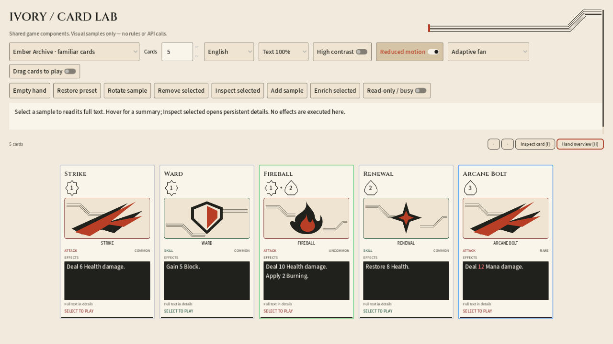
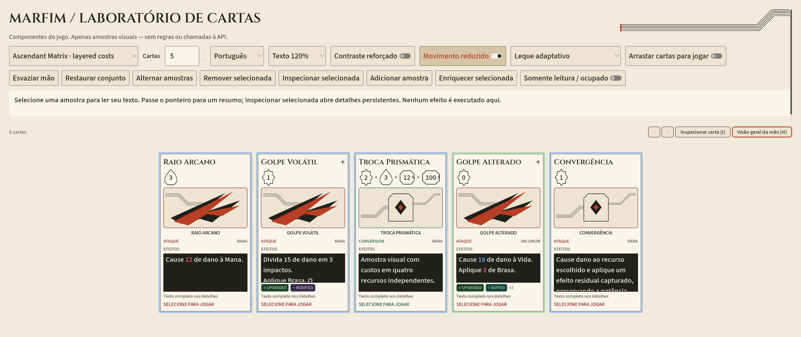
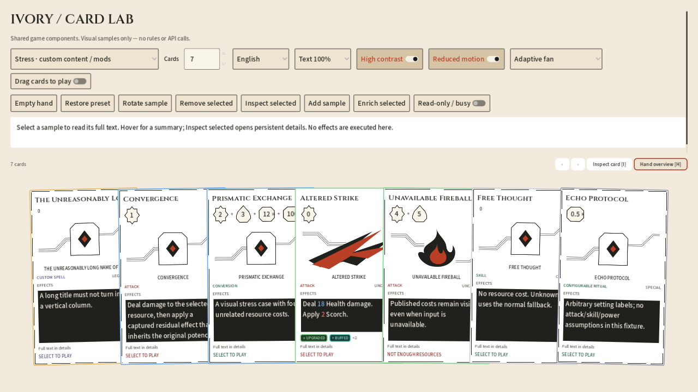

# Símbolos de custo — Marfim

2026-10-11. Refinamento visual do laboratório; não modifica custos, recursos, regras ou preferências persistidas.

- Energia: selo radiante com um único contorno em tinta.
- Mana: gota facetada, também com um único contorno. Nenhum símbolo de recurso tem linhas internas ou detalhes vermelhos.
- Número central: texto nativo, separado do SVG; suporta valores zero, decimais e múltiplos dígitos sem quebra de linha.
- Recurso customizado: vetor configurável por `resources.<id>.cost_icon`; fallback neutro com sigla no canto e nome completo nos detalhes. Nenhuma decisão por ID de recurso no componente.
- Dimensões e fonte em `CardVisualStyle`. Altura-base Marfim 404; rodapés dentro da face também com texto a 120%.
- Os símbolos são passivos e não mudam seleção/input. Tema de produção e cores de comparação dos efeitos permanecem intactos.

## Conferência

```powershell
./tools/test-godot-ui.ps1 -Tests card_cost_symbols,ivory_lab,card_presentation,component_context,hand_ux -VisualTest ivory_lab_visual -VisualOutputDirectory .runtime/ivory-cost-symbols
```

O runner usa uma cópia isolada e não chama a API. A suite específica cobre vetores distintos, valor publicado, centralização, escala 100/120%, custo composto/alternativo, recursos desconhecidos, vetor inexistente, configuração de um recurso customizado e preservação do perfil anterior. A suite renderizada confere os rodapés e gera 18 capturas em inglês/português, 1280×720 e 2560×1080, incluindo alto contraste. Três capturas representativas ficam neste diretório; a geração completa permanece no diretório de saída do runner.

[Relatório dos testes](validation.json): 209 verificações funcionais e 47 verificações renderizadas, todas aprovadas. Os avisos de ObjectDB no encerramento de `card_presentation` e `component_context` continuam registrados separadamente dos resultados funcionais.

## Capturas






