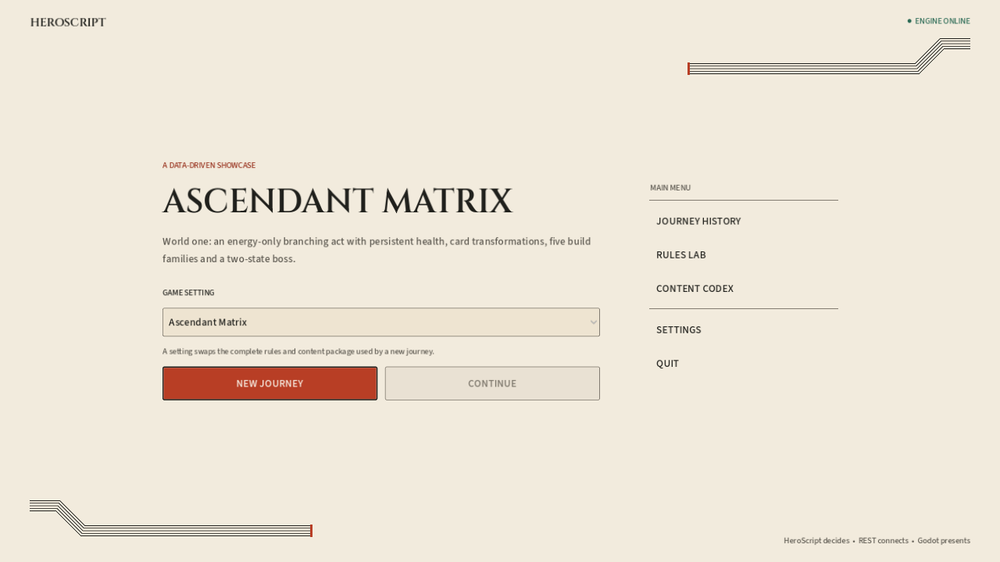
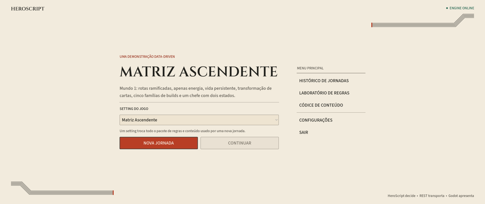
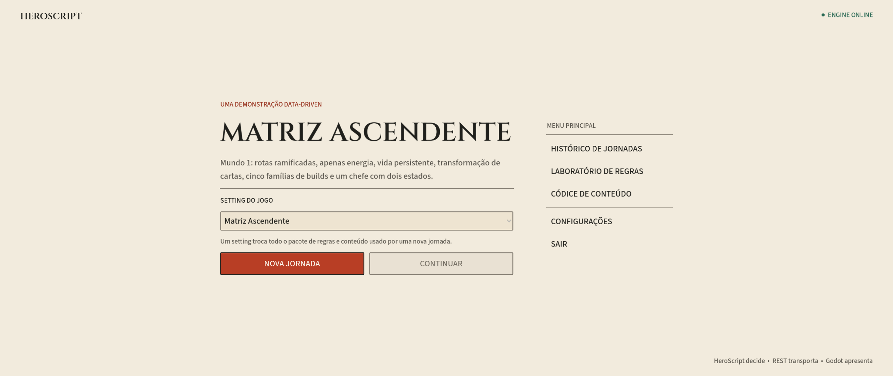

# Menu principal Marfim — capturas

Capturas reais da rota de produção com catálogo/histórico sintéticos e serviços isolados. Não são mockups nem evidência de balanceamento. Descrição do Ascendant usa a mesma chave do conteúdo atual; histórico vazio deixa Continuar desabilitado.

[Escopo, arquitetura e reprodução](../../IVORY_MAIN_MENU.md). [Relatório de validação](validation.json): 220 verificações offline e 51 verificações renderizadas, todas aprovadas. Os avisos de encerramento ObjectDB das suites existentes ficam registrados no relatório e não são apresentados como encerramento totalmente limpo.

O teste renderizado gera onze imagens: oito combinações de quatro resoluções e dois idiomas, uma com nome de setting extenso, uma em alto contraste e uma offline. Três capturas representativas são preservadas aqui; as demais ficam na saída do runner.

