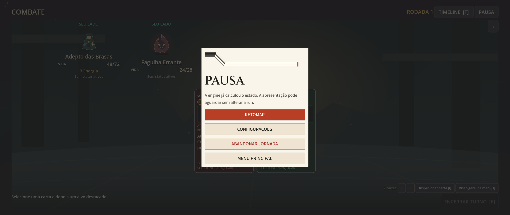
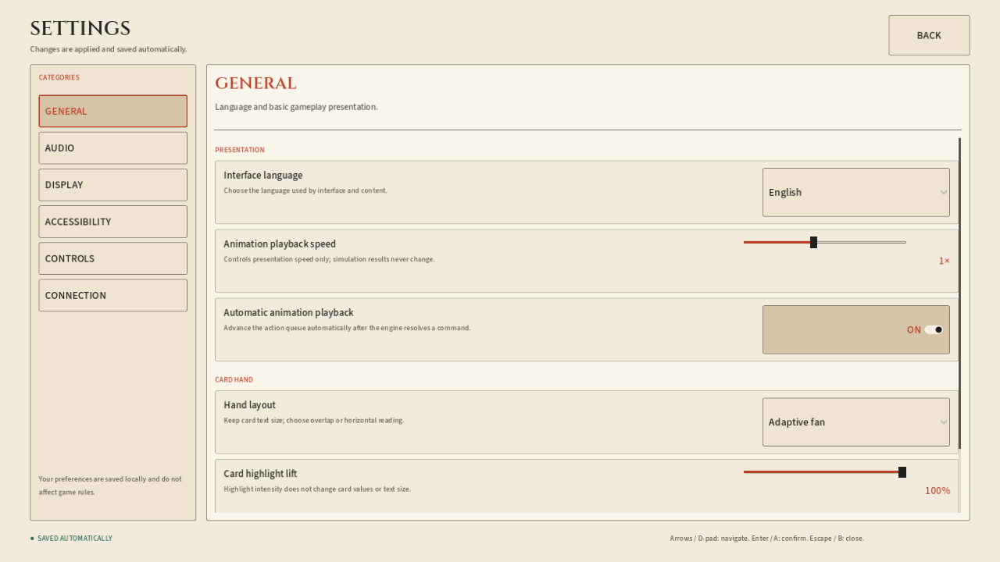
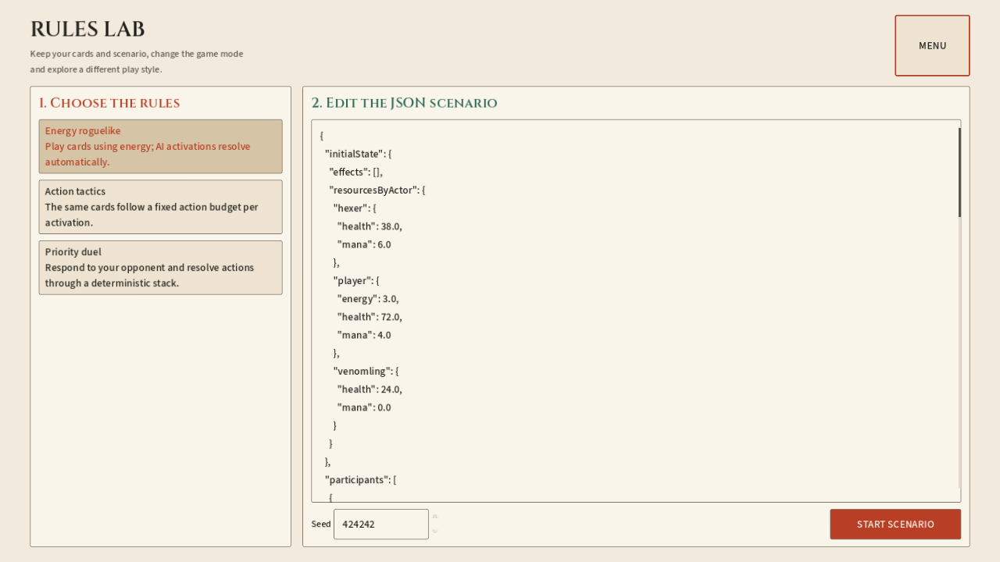
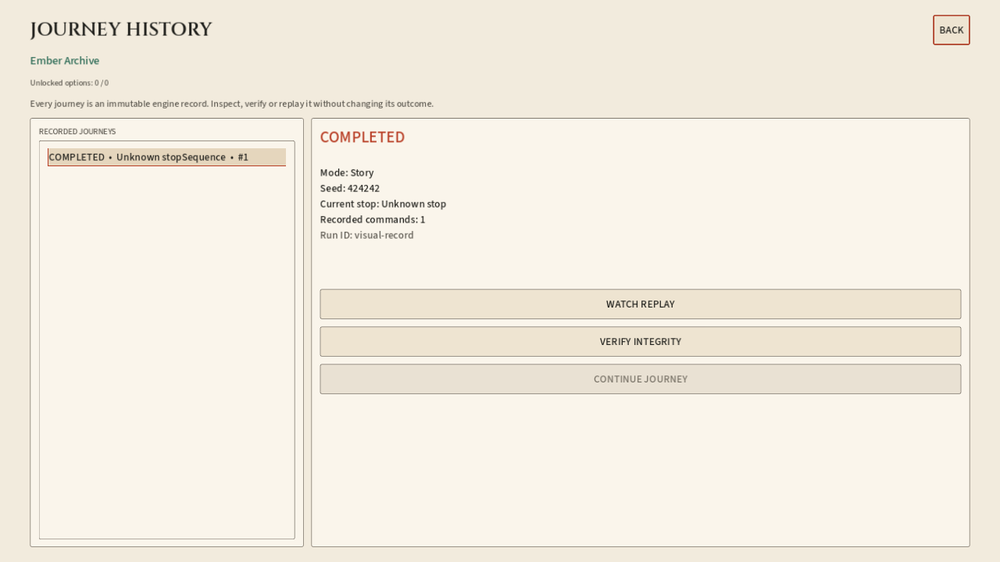
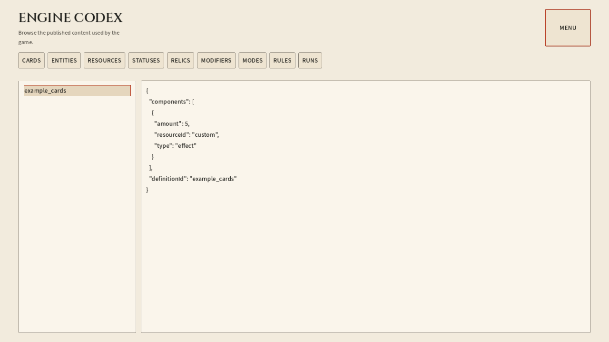

# Menus e pausa — evidências

302 verificações offline e 126 renderizadas, aprovadas. A execução final teve código 0 em todas as suites. [Relatório](validation.json); [escopo, arquitetura e reprodução](../../IVORY_MENUS_AND_PAUSE.md).

São 36 capturas geradas pela suite com dados sintéticos e componentes reais. Cinco representativas ficam neste diretório; a geração completa fica na saída do runner. EN/PT, 1280×720 e 2560×1080; português exercita texto a 120%. Menus não acionam HTTP real nem mudam registros do jogador. Avisos ObjectDB das suites existentes estão conservados no relatório, assim como a descrição da instabilidade nativa e da cópia importada reutilizada no guia.

