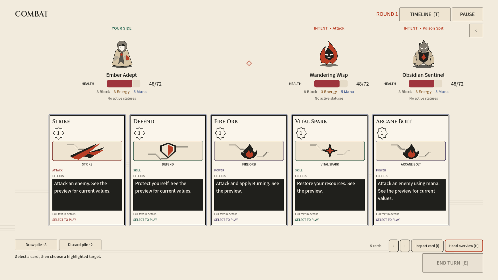
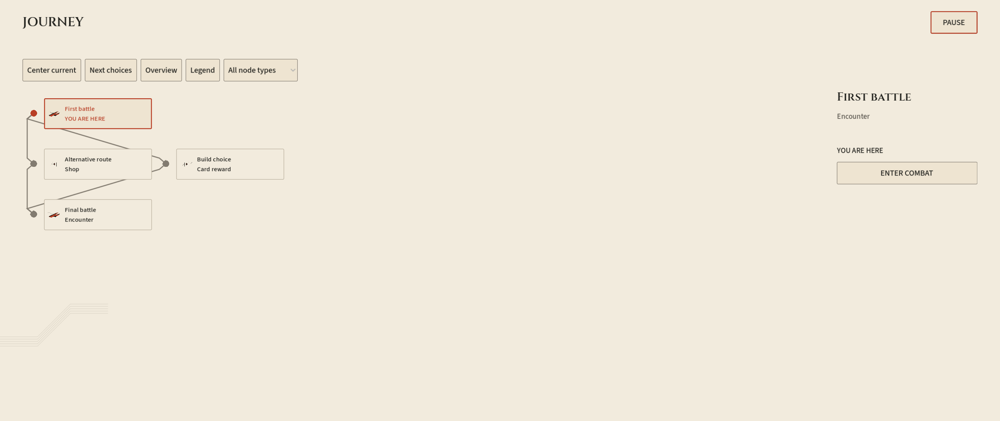
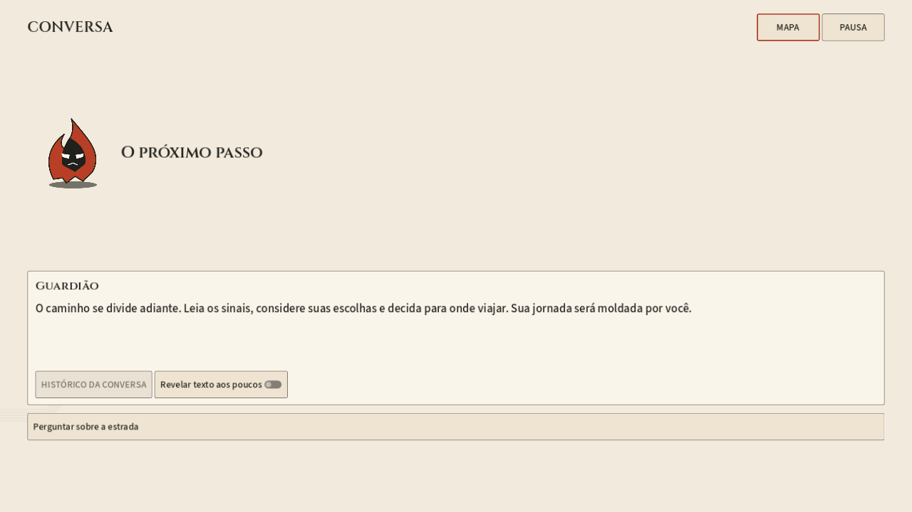

# Run Marfim — implementação e certificação

Data: 2026-10-12. Plano: [10 etapas + preparação](../../../plans/GODOT_IVORY_RUN_AND_DIALOGUE_PLAN.md).

## Entrega

Mapa amplo e inspecionável, navegação local com pan/foco/centralização/overview/destaque por tipo, inspector separado e travel por opção publicada. Ciclos são agrupados por SCC sem mudar o grafo da engine.

Diálogos têm cena/controller próprios, palco com retrato, caixa de fala inferior, escolhas e histórico em modal somente leitura. Texto instantâneo por padrão, revelação opcional e páginas locais; confirmar a leitura nunca escolhe uma consequência. Custos/condições/efeitos continuam na engine. Metadata opcional speakerId e Choice/Continue não autoriza autoescolha.

Combate e atividades usam os componentes existentes com perfil Marfim. UI, cenário, anatomia de carta e geometria têm Resources independentes. A carta da run tem arte mais compacta que a do laboratório, sem reduzir a fonte dos efeitos; isso permite acomodar o HUD com fonte em 120%. Recursos customizados continuam exibidos. Pausa é um overlay independente, e o playback continua com um único cursor.

## Capturas revisadas

Capturas são fixtures da composição real, não partidas ou resultados de balanceamento. Foram geradas 36 imagens (combate, pausa, mão vazia, mapa, recompensa, diálogo × EN/PT × 1280×720/1920×1080/2560×1080), com 73 verificações aprovadas. Três exemplos representativos ficam versionados aqui; o conjunto completo foi gerado em `.runtime/ivory-run-final-captures`.

## Evidências

| Verificação | Resultado |
| --- | --- |
| Build Release da API | Sucesso, zero warnings/erros |
| Core.Tests completo | 1.661 testes aprovados |
| API.Tests completo | 208 testes aprovados; execução em 7m03s com TestSessionTimeout=900000 |
| Diálogo REST + UI | 32 checks; preço, carta real, memória, retomada, término e replay; EN/PT e duas resoluções |
| Mão online default/ascendant | 150 checks; identidade/foco, resoluções/fonte, uso e replay |
| Volatile-core online | 8 checks; revisão, launch, combate, localização e projeção de procs |
| Campanha + UI + histórico/replay | gameplay_polish: 175 checks |
| Campanha normal canônica | campaign_online: 3 checks; conclusão e replay válido |
| Combate offline | 441 checks; fonte 100/120%, EN/PT, quatro resoluções, custos alternativos, sidebar, mão vazia e pause |
| Pausa / mão / seleção após jogar / troca de composição / lifecycle | 24 / 37 / 22 / 13 / 7 checks |
| Menus/pausa Marfim | 90 checks |
| Escopo de progressão por setting | 30 checks |
| Leitura / referência de diálogo / coordenação | 7 / 6 / 6 checks |
| Mapa: geometria / view / inspeção e câmera | 10 / 8 / 13 checks |
| Ingresso de atividades / contratos Marfim | 8 / 9 checks |

A suíte offline padrão do runner cobre também configurações, recuperação, concorrência, fronteiras passivas, preços e preview. Vinte refreshes idênticos de combate produziram zero substituições de nodes, zero relayouts da mão e zero leituras adicionais; média síncrona local de aproximadamente 0,525 ms. Não é uma medida de rede/GPU ou clique→resultado.

## Isolamento e limites

- API QA própria em 5293, perfil normal, persistência em `.runtime/ivory-run-qa`; servidor das partidas pessoais não foi usado.
- Godot em cópia/importação isolada, com diretório de usuário próprio; importação final do projeto fonte também concluiu sem erros.
- A primeira execução completa da API abortou pelo limite padrão de 5 minutos após 206 testes aprovados; a repetição com janela maior concluiu os 208.
- O smoke antigo inclui ferramentas privilegiadas de sandbox e recebeu 403 no host normal. Não foram habilitadas permissões administrativas para contornar isso. A certificação online desta entrega usa a campanha normal e os testes específicos; não afirma cobertura online das ferramentas privilegiadas de modding.
- Alguns runners ainda reportam dois ObjectDB residentes no encerramento; foram registrados separadamente. O teste de lifecycle mostrou contagem limitada após aquecimento e nenhuma nova fuga de nodes/sinais nos componentes testados. Não se declara encerramento global livre de avisos.
- Esta entrega não certifica balanceamento, duração do ato, arte final, dublagem ou interrupção narrativa no meio de uma resolução de combate.

## Reproduzir

Na raiz, `./tools/test-godot-ui.ps1` executa a suíte offline. Para online, use `-Tests dialogue,hand_online,volatile_core_online,gameplay_polish,campaign_online -ApiUrl <URL da API QA>`; esses testes criam runs, portanto não use a API das partidas pessoais. Para capturas use `-VisualTest ivory_run_visual -VisualOutputDirectory <diretório>`.

Core: `dotnet test tests/Core.Tests/Core.Tests.csproj --no-restore`. API: `dotnet test tests/API.Tests/API.Tests.csproj --no-restore -- RunConfiguration.TestSessionTimeout=900000`.

Contratos e extensão visual: [GODOT_RUN_GRAPHICS_CONTRACTS](../../GODOT_RUN_GRAPHICS_CONTRACTS.md), [GODOT_VISUAL_PROFILES](../../GODOT_VISUAL_PROFILES.md), [diálogos](../../../systems/dialogue-system.md).
