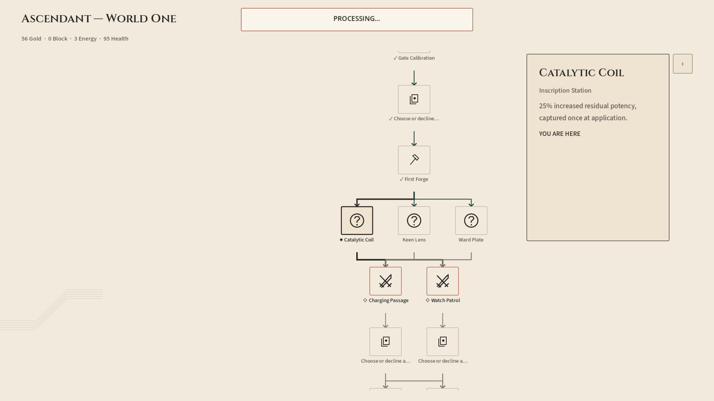

# Validação do mapa na Godot com API real

Data: 2026-10-19.

## Correção posterior da indicação visual

A ressalva registrada abaixo foi corrigida após esta auditoria: a legenda do nó atual concluído mostra `● ✓`, e o painel combina as traduções de `YOU ARE HERE` e `COMPLETED`. A captura e os resultados REST abaixo preservam a evidência anterior à correção.

O novo teste `tests/map_completion_status.gd` reproduziu o defeito antes da mudança (8 falhas) e passou depois (30 verificações). Cobre inglês/português, nó atual não concluído, atual concluído, concluído após avançar, retorno ao nó concluído e remoção do estado de conclusão; também verifica identidade dos botões, ausência de comandos e preservação dos dados de entrada. Foi incluído na suíte padrão. A validação local posterior somou **87 verificações aprovadas** nos testes `map_completion_status`, `map_selection`, `map_graph_view`, `map_auto_completion` e `activity_map_completion`. A correção é exclusivamente de apresentação; não altera a engine nem as regras de conclusão.

## Resultado

O fluxo funcional passou em duas execuções renderizadas: **343 verificações por execução**, saída 0, sem erros de script ou diagnósticos da Godot. Há uma ressalva visual confirmada: um nó concluído que ainda é o local atual não exibe sua conclusão explicitamente.

## Ambiente e isolamento

- Godot 4.7.2, renderer Compatibility, janela 1920×1080.
- Cena principal, roteador, telas, componentes, controllers e gateway de produção. O teste aciona os sinais dos botões reais e os mesmos handlers usados pelas telas; não é um teste de ponteiro físico/hit-testing.
- API compilada do workspace, Kestrel em `http://127.0.0.1:5298`; nenhum mock de respostas ou alteração artificial do estado da run.
- Setting `ascendant`, campanha publicada `ascendant_world_one_run`, seed 154.
- API com stores próprios em `.runtime/map-rest-20261019-v2/{runs,content,telemetry}`. Godot em cópia de teste com diretório de usuário próprio. Os saves pessoais e a API habitual não foram usados.
- Combate com movimento reduzido e animações automáticas para testar navegação, não o acabamento das animações.
- O servidor de teste foi encerrado após a validação; os artefatos foram preservados.

## Caminho exercitado

1. Criar a campanha e entrar no primeiro combate pela tela de mapa.
2. Jogar cartas e terminar turnos pelos handlers da tela de combate até vencer.
3. Escolher uma recompensa na tela de atividade; conferir resolução canônica e avanço automático quando só existe um destino.
4. Repetir o segundo combate e recompensa, chegando à First Forge.
5. Usar o retorno ao mapa da First Forge; conferir `s03_forge` em `resolvedNodeIds` sem executar um comando local de conclusão.
6. Na bifurcação, pressionar o nó Catalytic Coil (`relic_dot`), abrir seu painel e pressionar o botão real de viagem.
7. Abrir a oferta de inscrição e escolher uma opção pela tela de atividade; a coordenação de produção conclui o nó e retorna ao mapa.
8. Medir centralização e estabilidade do painel no mapa final e verificar o replay semântico da run.

## Verificações e evidências

| Item | Resultado |
|---|---|
| Viagem para o nó selecionado | `currentNodeId == relic_dot` após a chamada REST |
| Conclusão da atividade | `relic_dot` presente em `resolvedNodeIds` |
| Retorno | Tela final `map`, sequência 34 |
| Centralização | Erro medido de **0,000 px**, tolerância de 2 px, entre centro do botão atual e centro da área rolável |
| Painel flutuante | Retângulos globais de todos os nós, viewport, extensão do canvas, origem do grafo e scroll idênticos antes/depois de alternar o painel |
| Inspeção | Nenhuma alteração na sequência da run ao alternar o painel |
| Projeção | Flags `resolved` dos nós iguais aos dados retornados pela API |
| Nós concluídos anteriores | Legenda com `✓` confirmada |
| Replay | `isValid == true` |
| Snapshots | Cópia anterior a cada comando permanece inalterada; não substitui uma certificação abrangente de imutabilidade da engine |

A consulta HTTP independente ao fim confirmou:

```json
{
  "runId": "a6bd2fad-b2d1-8867-89cc-b4796da87ad1",
  "sequence": 34,
  "currentNodeId": "relic_dot",
  "resolvedNodeIds": [
    "r01", "r02", "relic_dot", "s01_arrival", "s02_gate", "s03_forge"
  ]
}
```

## Ressalva visual: atual e concluído não aparecem juntos

Na captura final, Catalytic Coil está concluído na API e na projeção, mas sua legenda usa `●` e o painel informa apenas `YOU ARE HERE`. A renderização dá prioridade a `current` sobre `resolved`:

- `scripts/ui/route_view.gd`: expressão de `state_label` escolhe `●` antes de considerar `✓`.
- `scripts/ui/map_view.gd`: expressão de `status` escolhe `YOU ARE HERE` antes de considerar `COMPLETED`.

Portanto, **persistência/conclusão, centralização e geometria estão corretas no caminho testado; a comunicação visual da conclusão do nó atual ainda é ambígua**. A captura não deve ser interpretada como falha da API nem como certificação de que esse detalhe visual foi corrigido. Nenhum código de gameplay ou de apresentação foi modificado nesta auditoria.



## Reprodução

Teste: `examples/godot-engine-showcase/tests/map_rest_flow.gd`.

Iniciar uma API exclusivamente de QA na porta 5298, configurando explicitamente os três caminhos de persistência para uma pasta vazia e isolada. Não apontar este teste para dados de jogador.

```powershell
& tools/test-godot-ui.ps1 `
  -Tests map_rest_flow `
  -VisualTest map_rest_flow `
  -VisualOutputDirectory .runtime/map-rest/screenshots `
  -VisualResolution 1920x1080 `
  -ApiUrl http://127.0.0.1:5298 `
  -TimeoutSeconds 240
```

O runner acrescenta `VisualTest` à lista de testes; essa chamada executa deliberadamente o fluxo duas vezes. Os resultados desta validação estão em `validation.json`: 32,254 s e 27,641 s para o fluxo completo, não para uma ação individual.

Limites: este teste não cobre todas as atividades, idiomas, resoluções, controle físico do mouse/gamepad ou reinício do servidor. Uma primeira tentativa do probe foi descartada por tratar campos nulos de aplicações não numéricas como números; os resultados acima são das duas execuções posteriores, com o probe corrigido.
