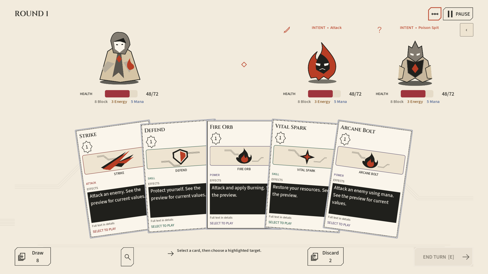
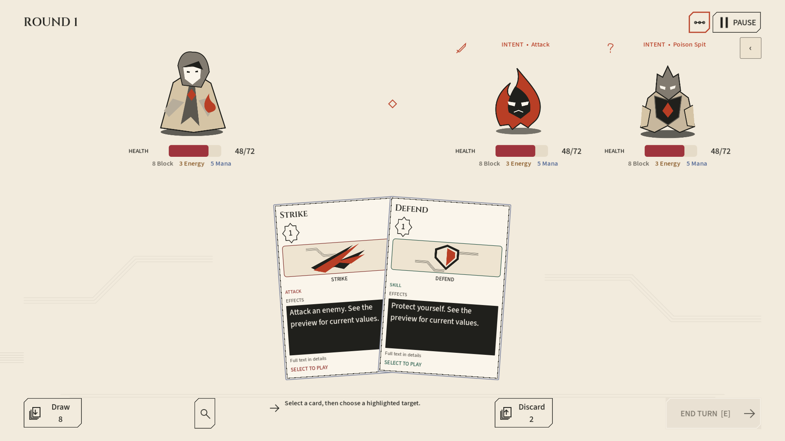
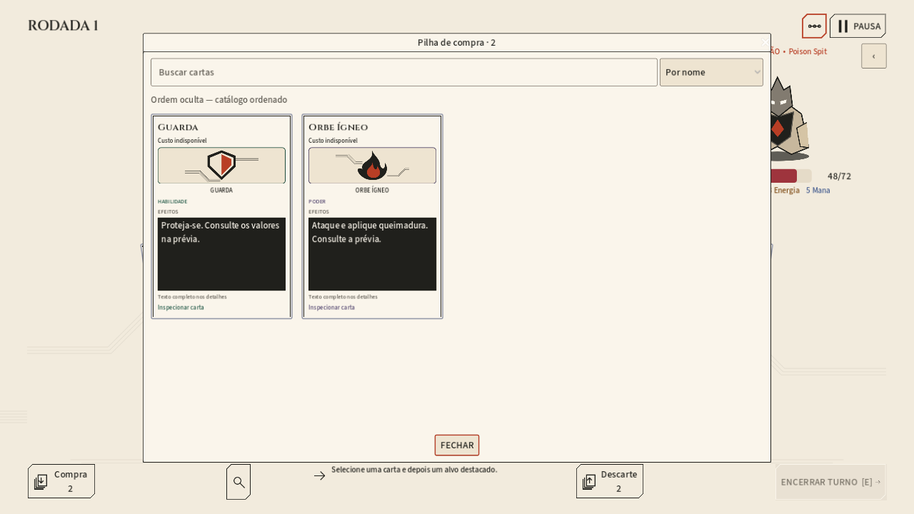

# Combate Marfim — composição de referência

Entrega de 2026-10-12, seguindo o [plano](../../../plans/GODOT_COMBAT_REFERENCE_LAYOUT_HAND_AND_PILES_PLAN.md). Baseline anterior preservada em `.runtime/reference-combat-before`; a imagem enviada orienta proporções, não exige ilustrações finais.

## Resultado

- Mão central com largura proporcional limitada, inclusive em ultrawide; atores maiores e informações essenciais sob as silhuetas.
- Adaptive fan independente de compressão: duas cartas têm inclinação oposta, uma permanece reta, e reading continua uma alternativa acessível.
- Header/dock com família SVG e contornos angulares; ações continuam controles nativos. Hand overview não existe no combate nem nos remaps. Seu consumidor local do laboratório permanece.
- Pilhas nas bordas do dock, separadas da geometria da mão. Ícones/posição podem ser configurados pela apresentação da zona; fallback genérico para novos settings.
- Browser com CardView compartilhado, busca, ordenação local, detalhes e retorno de foco. Conteúdo oculto não é vazio; ordem oculta não vaza a próxima compra.
- Inspeção individual sob demanda pela REST existente, cache contextual/coalescência e concorrência limitada. Nenhuma fórmula, condição ou regra de cartas foi transferida para a Godot.

## Verificação

| Teste | Resultado |
| --- | --- |
| Geometria de mão 0/1/2/3/5/10/20 | 21 checks; fan simétrico, reading plano e altura reservada estável |
| Coleções offline | 9 checks; endereços, ordem/visibilidade, faces, busca, viewport e leitura sem HTTP |
| Coleções REST nos três settings | 25 checks; detalhes canônicos e snapshots/seleção/replay inalterados |
| Mão online default/ascendant | 150 checks |
| Layout de combate | 441 checks; quatro resoluções, EN/PT, fonte 100/120%, sidebar/pointer/pause e mão vazia |
| Seleção após play / arquitetura passiva / pausa | 22 / 27 / 24 checks |
| Configurações interativas | 82 checks |
| Suíte offline padrão | Aprovada, incluindo recuperação, fronteiras, contexto visual, cards/custos e diálogo |

Foi corrigida uma regressão encontrada pela matriz: reaplicar o contador de pilha reiniciava sua fonte sem a escala visual, deslocando o dock em quatro pixels. A factory agora preserva tamanhos canônicos e reaplica preferências aos overrides. Mão/cenário/dock não mudam de tamanho por abrir a sidebar ou esvaziar a mão.

## Capturas

Fixtures da composição real, sem HTTP. Matriz final: EN/PT × 1280×720/1920×1080/2560×1080 × mãos de 0/1/2/5/10/20 cartas e uma coleção visual. O conjunto completo fica em `.runtime/reference-combat-certified`; os exemplos abaixo são versionados.

## Limites

Artes são placeholders. Nomes/ícones de intenção vêm de apresentação sobre fatos publicados; não há fila de ativação inventada. A avaliação de uma carta fora da zona jogável pode não publicar custo contextual; a UI indica essa ausência, sem mostrar zero ou recalcular scaling. Uma carta não visível não é consultada.

QA usa API normal própria em 5293 e persistência `.runtime/reference-combat-qa`, além de user directory Godot isolado. Não foram usados saves pessoais ou permissões privilegiadas. Alguns runners mantêm avisos ObjectDB de encerramento já registrados nas certificações anteriores; não são tratados como aprovação silenciosa de um teardown global livre de avisos.

Reproduzir: `./tools/test-godot-ui.ps1` para offline. Para online, `-Tests card_collections_online,hand_online -ApiUrl <API QA>`. Capturas: `-VisualTest reference_combat_visual -VisualOutputDirectory <diretório>`. Testes online criam runs: não use a API das suas partidas.
