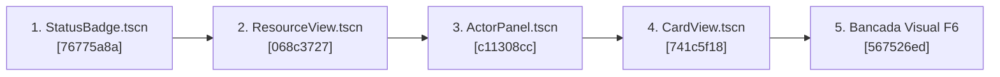

# Plano Detalhado: Migração da UI Godot para o Modelo Híbrido

**Status:** Concluído com Sucesso (5/5 etapas implementadas e commitadas)  
**Objetivo:** Permitir ajustes finos visuais diretamente no editor da Godot (arrastar âncoras, ajustar margens, inspecionar fontes e cores no 2D Canvas) mantendo o mesmo repositório e a suíte completa de testes automatizados headless intacta.

---

## 1. Visão Geral da Arquitetura Híbrida

Antes desta migração, a UI do Godot funcionava como um "renderizador cego": centenas de linhas de código GDScript instanciavam containers e labels dinamicamente, deixando o editor visual vazio.

A **Arquitetura Híbrida** resolve isso dividindo a responsabilidade:

```text
┌────────────────────────────────────────────────────────────────────────┐
│                   ARQUITETURA HÍBRIDA PROFISSIONAL                     │
│                                                                        │
│   ┌───────────────────────────┐      ┌─────────────────────────────┐   │
│   │     CENA VISUAL (.tscn)   │      │    PRESENTER (GDScript)     │   │
│   ├───────────────────────────┤      ├─────────────────────────────┤   │
│   │ • Hierarquia no Editor 2D │ ◄─── │ • Não cria nós do zero      │   │
│   │ • Margens, âncoras, fontes│      │ • Faz @onready via %Node    │   │
│   │ • Design Tokens padrão    │      │ • Aplica DTOs do backend    │   │
│   │ • Preview ao vivo (@tool) │      │ • Reconcilia apenas listas  │   │
│   └───────────────────────────┘      └─────────────────────────────┘   │
└────────────────────────────────────────────────────────────────────────┘
```

1. **A Cena (`.tscn`) é a "Pele" Visual:**
   - O desenvolvedor ou artista abre a cena (ex: `actor_panel.tscn`) no Godot e vê o combatente montado.
   - Ajustes de padding, cores de contorno, tamanhos de fonte e âncoras são feitos arrastando e configurando no Inspetor.
2. **O Script (`.gd`) é o Presenter:**
   - Possui `@tool` no topo: se estiver no editor (`Engine.is_editor_hint()`), renderiza dados de exemplo para que o componente não fique invisível na tela.
   - Em tempo de execução, recebe o read model do backend e popula os nós existentes (`%HealthBar.value = hp`).
3. **O Reconciler gerencia apenas coleções:**
   - Em vez de diffar a árvore inteira, o `view_reconciler.gd` gerencia listas que aumentam/diminuem (cartas na mão, fileira de status badges).

---

## 2. Roteiro de Execução e Status dos Commits



---

### Tarefa 1: Componente Atômico `StatusBadge.tscn`
- **Status:** **CONCLUÍDO** (Commit `76775a8a`)
- **O que faz:** Transforma o quadradinho de 26×26px de buffs/debuffs em uma cena `.tscn` visual com preview `@tool`.
- **Arquivos:**
  - `scenes/ui/components/status_badge.tscn`
  - `scripts/ui/components/status_badge.gd`
  - `scripts/ui/actor_panel.gd` (refatorado para instanciar a cena)
- **Validação:** `tests/actor_panel_polish.gd` (PASS).

---

### Tarefa 2: Componente `ResourceView.tscn` (Barra de Vida & Escudo)
- **Status:** **CONCLUÍDO** (Commit `068c3727`)
- **O que faz:** Cria a cena visual para barras de progresso com label de nome, barra estilizada e indicador numérico `75/100`.
- **Arquivos:**
  - `scenes/ui/components/resource_view.tscn`
  - `scripts/ui/resource_view.gd`
- **Validação:** `tests/semantic_cues.gd` e `tests/ui_reconciliation.gd` (PASS).

---

### Tarefa 3: Painel do Combatente `ActorPanel.tscn`
- **Status:** **CONCLUÍDO** (Commit `c11308cc`)
- **O que faz:** Monta o combatente completo da arena tática em uma cena `.tscn` reutilizável:
  1. Título do Ator (`%ActorTitle`)
  2. Intenção do Inimigo (`%ActorIntentRow` com ícone + valor)
  3. Barra de Vida no topo (`%HealthBarContainer`)
  4. Fileira de Status Badges (`%ActorStatusBadges`)
  5. Retrato clicável (`%ActorTarget`)
- **Arquivos:**
  - `scenes/ui/components/actor_panel.tscn`
  - `scripts/ui/actor_panel.gd`
- **Validação:** `tests/actor_panel_polish.gd` (10/10 PASS) e `tests/resolutions.gd -- --layout-smoke` (PASS).

---

### Tarefa 4: Componente de Carta Tátil `CardView.tscn`
- **Status:** **CONCLUÍDO** (Commit `741c5f18`)
- **O que faz:** Cria a cena `.tscn` visual para a carta tátil com nós pré-posicionados (margens, cabeçalho, custo em recursos, arte, tipo e texto de regras) e suporte a live `@tool` preview de cartas no canvas 2D da Godot.
- **Arquivos:**
  - `scenes/ui/components/card_view.tscn`
  - `scripts/ui/card_view.gd`
  - `scripts/ui/card_cost_line.gd`
  - `scripts/ui/card_title.gd`
  - `tests/card_titles.gd`
- **Validação:** `tests/card_presentation.gd` (failures=0), `tests/card_titles.gd` (157 PASS) e `tests/card_face_rows.gd` (544 PASS).

---

### Tarefa 5: Workbench Visual e Verificação de Regressão Contínua
- **Status:** **CONCLUÍDO** (Commit `567526ed`)
- **O que faz:** Cria a cena bancada visual `ui_catalog_workbench.tscn` que reúne `ActorPanel`, `StatusBadge`, `ResourceView` e `CardView` lado a lado com dados mockados. Permite ao dev abrir a cena no Godot e ver imediatamente tudo renderizado com tipografia, estilo e métricas reais, além de poder rodar F6 direto nela.
- **Arquivos:**
  - `scenes/ui/workbenches/ui_catalog_workbench.tscn`
  - `scripts/ui/workbenches/ui_catalog_workbench.gd`
  - `tests/workbench_smoke.gd`
- **Validação:** `tests/workbench_smoke.gd` (PASS) e suíte completa de contratos e smoke tests.

---

## 3. Resumo dos Commits no Repositório

| Etapa | Commit | Mensagem do Commit | Componente Principal |
| :--- | :--- | :--- | :--- |
| **Etapa 1** | `76775a8a` | `feat(ui): implement Step 1 of hybrid UI with StatusBadge.tscn and @tool preview` | [status_badge.tscn](file:///C:/Users/usuario/.gemini/antigravity/scratch/HeroScript/examples/godot-engine-showcase/scenes/ui/components/status_badge.tscn) |
| **Etapa 2** | `068c3727` | `feat(ui): implement Step 2 of hybrid UI with ResourceView.tscn and @tool preview` | [resource_view.tscn](file:///C:/Users/usuario/.gemini/antigravity/scratch/HeroScript/examples/godot-engine-showcase/scenes/ui/components/resource_view.tscn) |
| **Etapa 3** | `c11308cc` | `feat(ui): implement Step 3 of hybrid UI with ActorPanel.tscn and live @tool preview` | [actor_panel.tscn](file:///C:/Users/usuario/.gemini/antigravity/scratch/HeroScript/examples/godot-engine-showcase/scenes/ui/components/actor_panel.tscn) |
| **Etapa 4** | `741c5f18` | `feat(ui): implement Step 4 of hybrid UI with CardView.tscn and @tool preview` | [card_view.tscn](file:///C:/Users/usuario/.gemini/antigravity/scratch/HeroScript/examples/godot-engine-showcase/scenes/ui/components/card_view.tscn) |
| **Etapa 5** | `567526ed` | `feat(ui): implement Step 5 of hybrid UI with ui_catalog_workbench.tscn for rapid F6 testing` | [ui_catalog_workbench.tscn](file:///C:/Users/usuario/.gemini/antigravity/scratch/HeroScript/examples/godot-engine-showcase/scenes/ui/workbenches/ui_catalog_workbench.tscn) |
