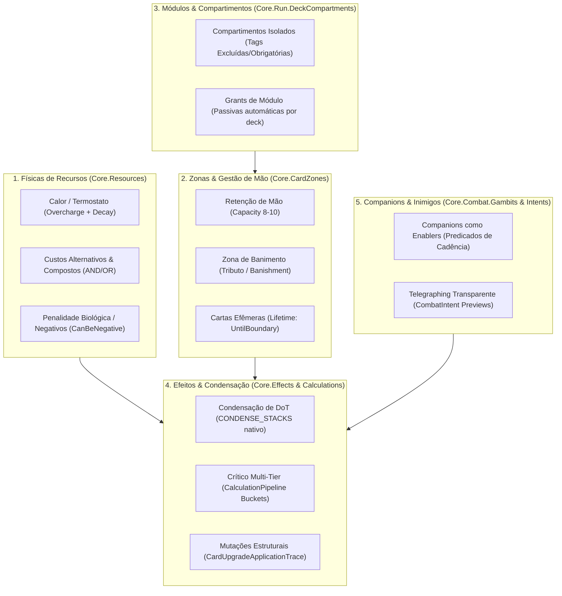
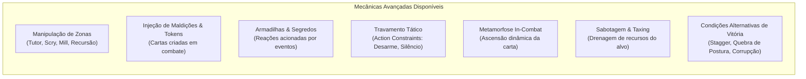

# ⚙️ Relatório Técnico-Mecânico: Mecânicas Viáveis para o HeroScript

**Engine:** HeroScript Core (.NET 10)  
**Documento de Referência:** [`direcionamento_heroscript.md`](file:///C:/Users/usuario/.gemini/antigravity/brain/7e671731-6f08-4a09-8880-fb0b3e8f7b66/direcionamento_heroscript.md)  
**Status do Backend:** Sistema data-driven completo em C#, desacoplado, compilado e com cobertura para todos os pilares propostos.

---

## 1. Visão Geral da Análise

A inspeção do código-fonte em [`HeroScript/src/Core`](file:///C:/Users/usuario/.gemini/antigravity/scratch/HeroScript/src/Core) revela que o motor foi construído sob uma **arquitetura de simulação desacoplada orientada a dados (Data-Driven ECS/Command Pattern)**. 

Ao contrário de engines convencionais onde regras como "custo de mana" ou "descarte no fim do turno" são fixas no código, a Core do HeroScript trata regras, zonas, custos e fluxos como **definições serializáveis em JSON**. 

Isso significa que **todas as viradas de design estabelecidas no `direcionamento_heroscript.md` já possuem infraestrutura nativa implementada na engine**, sem necessidade de gambiarras ou extensões emergenciais no backend.

---

## 2. Catálogo de Mecânicas Habilitadas pela Engine

---

### Mecânica 1: Físicas Assimétricas de Recursos e Termostato
* **Implementação no Código:** [`Core.Resources.ResourceDefinition`](file:///C:/Users/usuario/.gemini/antigravity/scratch/HeroScript/src/Core/Resources/ResourceDefinition.cs) e [`ResourceThresholdPolicy`](file:///C:/Users/usuario/.gemini/antigravity/scratch/HeroScript/src/Core/Resources/ResourceThresholdPolicy.cs).
* **Mecânicas Habilitadas:**
  1. **O Termostato (Baralho Ardente):**
     * Cartas não têm custo numérico de consumo; elas têm efeitos `MODIFY_RESOURCE` com operação `ADD` no recurso `heat`.
     * `CanExceedMax = true`: Permite que o calor suba até ou além de 100° (Superaquecimento).
     * `RegenerationConfig`: Configurado com `AmountPerTurn` negativo (ex: `-10` ou fórmula dinâmica) no timing `END_TURN`, fazendo o calor resfriar naturalmente todo turno.
     * `ResourceThresholdPolicy`: Dispara eventos ou consequências automáticas se o calor atingir limites críticos (ex: `heat >= 100` causa dano de queima no próprio herói ou impede certas ações).
  2. **Recursos de Sobrecarga e Dívida:**
     * `CanBeNegative = true`: Permite recursos que entram em déficit (ex: "Exaustão Muscular" ou "Dívida de Sangue"), onde você gasta mais do que tem e precisa pagar nos turnos seguintes.

---

### Mecânica 2: Custos de Ação Múltiplos e Alternativos
* **Implementação no Código:** [`Core.Combat.Models.ActionCosts`](file:///C:/Users/usuario/.gemini/antigravity/scratch/HeroScript/src/Core/Combat/Models/ActionCosts.cs) e [`AlternativeCostOption`](file:///C:/Users/usuario/.gemini/antigravity/scratch/HeroScript/src/Core/Combat/Models/AlternativeCostOption.cs).
* **Mecânicas Habilitadas:**
  1. **Custos Compostos (Lógica AND):** Uma carta pode exigir simultaneamente 2 de Energia E 20 de Calor para ser jogada.
  2. **Custos de Escolha Tática (Lógica OR):** O jogador escolhe como conjurar a carta:
     * *Opção A:* Pagar 3 de Energia;
     * *Opção B:* Pagar 12 de Vida (auto-dano);
     * *Opção C:* Banir 1 carta da mão.

---

### Mecânica 3: Bancada de Ferramentas (Retenção de Mão e Zonas Customizadas)
* **Implementação no Código:** [`Core.CardZones.CardZoneSystemDefinition`](file:///C:/Users/usuario/.gemini/antigravity/scratch/HeroScript/src/Core/CardZones/CardZoneDefinitions.cs) e [`CardZoneFlowExecutor`](file:///C:/Users/usuario/.gemini/antigravity/scratch/HeroScript/src/Core/CardZones/CardZoneFlowExecutor.cs).
* **Mecânicas Habilitadas:**
  1. **Retenção de Mão sem Descarte Obrigatório:**
     * A zona `Hand` tem `Capacity = 8` ou `10`.
     * O fluxo de início de turno executa `Move` da zona `Library` para `Hand` com `SelectionStrategy.Top` e contagem fixa (ex: compra 2 cartas), **sem disparar o descarte das cartas já presentes**.
     * Suporta `TargetZoneCountFormula`: comprar cartas até atingir N cartas na mão.
  2. **Zona de Banimento como Custo (O Tributo / Baralho do Vazio):**
     * A engine possui a operação `Move` com destino para a zona `Banishment`.
     * Cartas do Vazio utilizam um fluxo de zona (`CARD_ZONE_FLOW`) que seleciona uma carta da mão do jogador e a envia para o `Banishment` como pré-requisito da resolução.
  3. **Cartas Efêmeras e Prazos de Validade:**
     * `CardInstanceLifetimeDefinition` com `Strategy = UntilBoundary` e `Boundary = "turn_end"`.
     * Permite cartas que só duram o turno atual (geradas por combos) e desaparecem automaticamente se não forem usadas.

---

### Mecânica 4: Fusão Modular de Baralhos (Compartimentos de Deck)
* **Implementação no Código:** [`Core.Run.DeckCompartments.DeckCompartmentDefinition`](file:///C:/Users/usuario/.gemini/antigravity/scratch/HeroScript/src/Core/Run/DeckCompartments/DeckCompartmentDefinitions.cs).
* **Mecânicas Habilitadas:**
  1. **Baralhos Híbridos sem Mistura Caótica:**
     * O deck do jogador pode ser dividido em 2 compartimentos (ex: Compartimento 1 = "Ardente", Compartimento 2 = "Vazio").
     * Filtros de validação estritos: `RequiredTags = ["ardente"]` e `ExcludedTags = ["vazio"]`.
  2. **Grants Automáticos de Arquétipo:**
     * `DeckComponentGrant`: O próprio compartimento pode conceder passivas para todas as cartas inseridas nele (ex: "todas as cartas neste compartimento geram +2 de Calor adicional").

---

### Mecânica 5: Condensação Nativa de DoT (Detonação de Status)
* **Implementação no Código:** [`Core.Effects.CondensationRecipeDefinition`](file:///C:/Users/usuario/.gemini/antigravity/scratch/HeroScript/src/Core/Effects/CondensationRecipeDefinition.cs) e `EffectType.CONDENSE_STACKS`.
* **Mecânicas Habilitadas:**
  1. **Detonação Catastrófica de Queimadura / Sangramento / Veneno:**
     * A carta (ex: *Incinerar*) invoca um efeito do tipo `CONDENSE_STACKS` associado a uma `CondensationRecipeDefinition`.
     * O sistema seleciona os stacks do status no alvo (`AccumulatedStackSelection`).
     * `Consumption = AllSelectedStacks`: Remove todos os acúmulos da entidade.
     * `Aggregates`: Agrega a contagem de stacks (`StackCount`) ou a potência acumulada (`Payload`) em um parâmetro numérico (`condensation.stacks`).
     * Executa o dano concentrado em um único golpe crítico ou amplificado, sem a lentidão de esperar os turnos passarem.

---

### Mecânica 6: Cartas com Gatilhos Passivos e Condicionais em Runtime
* **Implementação no Código:** [`Core.Run.Content.CardComponentDefinition`](file:///C:/Users/usuario/.gemini/antigravity/scratch/HeroScript/src/Core/Run/Content/CardComponentDefinition.cs).
* **Mecânicas Habilitadas:**
  1. **Cartas Condicionais com Math Engine:**
     * `CardConditionComponentDefinition`: Avalia fórmulas matemáticas antes de permitir o jogo da carta (ex: `source.resources.heat.current >= 75`). Se falso, a carta fica inativa e exibe o motivo configurado.
  2. **Cartas que Reagem Paradas na Mão:**
     * `CardTriggerComponentDefinition`: Cartas seguradas na mão podem ter efeitos amarrados a fronteiras (ex: "ao final do turno, se esta carta estiver na sua mão, aumente sua Armadura em 4").
  3. **Influências Passivas de Mão:**
     * `CardInfluenceComponentDefinition`: Ter uma carta específica na mão altera canais de cálculo globais (ex: enquanto segurar esta carta, todos os seus ataques causam +15% de dano de fogo).

---

### Mecânica 7: Companions como Enablers Cadenciados e Previsão de Inimigos
* **Implementação no Código:** [`Core.Combat.Gambits.GambitDefinition`](file:///C:/Users/usuario/.gemini/antigravity/scratch/HeroScript/src/Core/Combat/Gambits/GambitDefinition.cs) e [`CombatIntent`](file:///C:/Users/usuario/.gemini/antigravity/scratch/HeroScript/src/Core/Combat/Intents/CombatIntent.cs).
* **Mecânicas Habilitadas:**
  1. **Companions Cadenciados (Ex: Elemental da Água a cada 3 turnos):**
     * O companion não requer IA estocástica complexa. Ele utiliza um `GambitDefinition` com um predicado simples: `turn_number % 3 == 0`.
     * Alvo automático: `TargetSelector.Strategy = LowestResource` ou `FirstOrdinal` (aplica *Molhado* no oponente principal).
     * Nos turnos 1 e 2, o predicado falha e o companion não age, exibindo o contador visual na tela.
  2. **Telegraphing Transparente de Inimigos:**
     * O Golem calcula seu `CombatIntent` no início da rodada.
     * O objeto `CombatIntent` já entrega mastigado para a UI os dados de intenção: tipo de ação, ícone, alvo e pré-cálculo de dano (`PreviewCalculations`), permitindo que o jogador tome decisões com 100% de clareza.

---

### Mecânica 8: Mutações Estruturais Permanentes (Progressão sem "Soquetes de ARPG")
* **Implementação no Código:** [`Core.Run.Content.EffectiveCardDefinition`](file:///C:/Users/usuario/.gemini/antigravity/scratch/HeroScript/src/Core/Run/Content/EffectiveCardDefinition.cs) e `CardUpgradeApplicationTrace`.
* **Mecânicas Habilitadas:**
  1. **Transformação Estrutural Audível:**
     * Em vez de microgerenciamento de inventário com gemas soltas, a engine permite aplicar patches diretos na definição da carta (`CardUpgradePatchDefinition`).
     * Exemplo: Uma carta de ataque tem seu componente de custo trocado permanentemente (deixa de custar Energia e passa a gerar Calor), ou seu efeito base ganha uma tag `Explosive`.
     * Cada mudança gera uma entrada imutável no `UpgradeTrace`, garantindo determinismo absoluto em replays.

---

## 3. Matriz de Cobertura do MVP

Tudo o que foi solicitado no experimento mínimo do documento de direcionamento tem mapeamento direto e imediato na engine:

| Requisito do MVP ([`direcionamento_heroscript.md`](file:///C:/Users/usuario/.gemini/antigravity/brain/7e671731-6f08-4a09-8880-fb0b3e8f7b66/direcionamento_heroscript.md#L83-L93)) | Componente Existente na Engine C# | Status Técnico |
|---|---|---|
| **Recurso Calor (Termostato)** | `ResourceDefinition` (`heat`, `CanExceedMax: true`, `Regeneration: -10`) | Pronto para uso |
| **Geração de Calor via Cartas** | `EffectType.MODIFY_RESOURCE` (`Operation: ADD`, `Target: SELF`) | Pronto para uso |
| **Escalonamento por Calor** | `CalculationBucketDefinition` com fórmula ou `CardCondition` | Pronto para uso |
| **Custos de Banimento (Vazio)** | `EffectType.CARD_ZONE_FLOW` (`Operation: Move`, `TargetZoneId: "Banishment"`) | Pronto para uso |
| **Retenção de Mão (Comprar 2, manter o resto)** | `CardZoneSystemDefinition` com `Capacity: 8` e fluxo de compra sem descarte | Pronto para uso |
| **Companion Cadenciado (3 turnos)** | `GambitDefinition` com predicado `turn % 3 == 0` | Pronto para uso |
| **Condensação de Queimadura (*Incinerar*)** | `EffectType.CONDENSE_STACKS` + `CondensationRecipeDefinition` | Pronto para uso |
| **Intenção do Golem Telegrafada** | `CombatIntent` + `IntentResolver` | Pronto para uso |

---

## 4. Conclusão e Próximo Passo Recomendado

A engine **não precisa de novas funcionalidades de código no backend** para suportar a visão do HeroScript. Toda a complexidade tática imaginada (mão retida, baralho ardente com calor, sacrifício em banimento, condensação de status e companions reativos) é puramente **configuração de dados JSON / Resources**.

O caminho mais eficiente agora é:
1. Manter a planilha [`cartas_prototipo.ods`](file:///C:/Users/usuario/.gemini/antigravity/scratch/HeroScript/docs/card-prototyping/cartas_prototipo.ods) como a ferramenta ágil de design para equilibrar números e textos;
2. Montar o arquivo de configuração de dados (`prototype-test.json`) mapeando essas 10 cartas e o Golem para alimentar a engine C#;
3. Executar o primeiro combate automatizado via console/API para validar se a máquina de regras entrega o ritmo desejado.

---

## 5. Novas Mecânicas de Card Game Habilitadas pela Engine (Ainda Não Exploradas)

A arquitetura do backend em [`HeroScript/src/Core`](file:///C:/Users/usuario/.gemini/antigravity/scratch/HeroScript/src/Core) contém subsistemas inteiros que vão muito além do escopo inicial de Calor e Banimento. 

Abaixo estão os arquétipos e mecânicas consagradas de card games que a engine já é capaz de executar nativamente:

---

### 5.1. Manipulação Avançada de Zonas: Tutores, Scry, Mill e Recursão
* **Subsistema:** [`Core.CardZones.CardZoneSelectionStrategy`](file:///C:/Users/usuario/.gemini/antigravity/scratch/HeroScript/src/Core/CardZones/CardZoneDefinitions.cs) e [`CardZoneOperation`](file:///C:/Users/usuario/.gemini/antigravity/scratch/HeroScript/src/Core/CardZones/CardZoneDefinitions.cs).
* **Mecânicas Possíveis:**
  1. **Tutor / Busca Direcionada:**
     - Uma carta com `SelectionStrategy.ByTags` e `RequiredTags = ["fogo"]` busca diretamente no baralho (`Library`) a próxima técnica ígnea e a move para a mão.
     - *Exemplo de Design:* *"Convocação das Brasas: Procure em seu grimório 1 carta Ardente e coloque na sua mão. Aumente o Calor em 10."*
  2. **Scry / Profecia (Manipulação do Topo do Baralho):**
     - O jogador inspeciona as próximas N cartas do baralho e pode reordená-las ou enviá-las para o fundo (`InsertionStrategy.Bottom`) ou descarte.
  3. **Mill / Descarte de Recursos do Oponente:**
     - Ataques que atacam a mente ou a resistência estrutural do inimigo podem mover cartas do baralho dele diretamente para o descarte, exaurindo as opções e combos do oponente em lutas longas.
  4. **Recursão de Cemitério / Reanimação de Cartas:**
     - Operação `Move` de `Discard` ou `Banishment` de volta para `Hand` ou `Library`.
     - *Exemplo de Design:* *"Cinzas Ressurgentes: Resgate 1 carta da sua pilha de Banimento de volta para a sua mão."*

---

### 5.2. Injeção Dinâmica de Maldições & Tokens (Hazard & Token Generation)
* **Subsistema:** [`Core.CardZones.CardZoneOperation.Create`](file:///C:/Users/usuario/.gemini/antigravity/scratch/HeroScript/src/Core/CardZones/CardZoneDefinitions.cs) e [`CardInstanceLifetimeStrategy`](file:///C:/Users/usuario/.gemini/antigravity/scratch/HeroScript/src/Core/CardZones/CardZoneDefinitions.cs).
* **Mecânicas Possíveis:**
  1. **Poluição da Mão do Inimigo com Maldições / Parasitas:**
     - O jogador pode criar instâncias de cartas como *Fuligem Asfixiante* diretamente na mão ou no baralho do inimigo.
     - Como a mão possui limite rígido de capacidade (`Capacity: 8`), essas cartas "lixo" bloqueiam a compra de golpes perigosos do chefe e causam dano ao herói ou inimigo quando compradas.
  2. **Criação de Tokens Efêmeros de Dano (Fleeting Sparks):**
     - Uma carta ardente potente pode injetar 3 cópias de *Centelha* na mão do jogador.
     - `LifetimeStrategy.UntilBoundary` com `Boundary = "turn_end"`: As centelhas custam 0 de energia, causam 2 de dano cada, mas desaparecem instantaneamente se o jogador encerrar o turno sem usá-las.

---

### 5.3. Cartas de Resposta, Segredos e Armadilhas (Trap Cards / Secrets)
* **Subsistema:** [`Core.GameplayEvents.Responses.GameplayResponseDefinition`](file:///C:/Users/usuario/.gemini/antigravity/scratch/HeroScript/src/Core/GameplayEvents/Responses/GameplayResponseDefinition.cs) e `CardResponseComponentDefinition`.
* **Mecânicas Possíveis:**
  1. **Armadilhas Armadas na Mesa:**
     - O jogador joga uma carta de "Postura de Contra-Ataque" que fica latente em uma zona de preparação.
     - O `ResponseFilter` monitora eventos: quando o inimigo atinge o Herói com um golpe de dano `> 12`, a armadilha dispara automaticamente (`PostFact`), reduz o dano recebido em 50% e devolve 15 de dano de fogo no atacante.
  2. **Gatilhos de Oportunidade:**
     - Uma resposta que monitora a cura do inimigo: *"Se o chefe tentar se curar, cause o dobro do valor curado como dano direto e quebre a cura."*

---

### 5.4. Travamento Tático de Ações (Action Constraints)
* **Subsistema:** [`Core.StatusEffects.StatusEffectDefinition.ActionConstraints`](file:///C:/Users/usuario/.gemini/antigravity/scratch/HeroScript/src/Core/StatusEffects/StatusEffectDefinition.cs).
* **Mecânicas Possíveis:**
  1. **Silêncio / Desarme / Concussão Estrutural:**
     - Em vez de um simples atordoamento binário ("pula a vez"), a engine permite travar categorias de ação específicas:
       - *Desarme:* O inimigo só pode usar feitiços ou buffs, ficando proibido de usar ataques físicos (`ActionType.BASIC_ATTACK` bloqueado).
       - *Silêncio:* O inimigo não pode conjurar habilidades (`ActionType.POWER` bloqueado).
       - *Garras de Gelo / Lentidão:* O inimigo é impedido de executar ações que custem mais de 1 de energia.
  2. **Provocar / Taunt e Redirecionamento de Agressão:**
     - Um status aplicado no Companion força o `TargetSelector` do Golem a mirar apenas nele durante a próxima rodada, protegendo o Piromaníaco em turnos de perigo iminente.

---

### 5.5. Metamorfose e Ascensão Dinâmica de Cartas (In-Combat Transformation)
* **Subsistema:** [`Core.Run.Content.CardTransformationSlotDefinition`](file:///C:/Users/usuario/.gemini/antigravity/scratch/HeroScript/src/Core/Run/Content/EffectiveCardDefinition.cs) e `CardUpgradePatchDefinition`.
* **Mecânicas Possíveis:**
  1. **Ascensão de Cartas por Desempenho no Combate:**
     - Uma carta de *Chama Inicial* começa simples. Se o jogador atingir 80° de Calor com ela na mão, a carta se transmuta permanentemente pelo resto daquela batalha em *Supernova*.
     - A engine aplica a mutação em runtime via `CardUpgradeState`, atualizando os efeitos e o feedback visual da carta de forma orgânica.
  2. **Fusão de Cartas na Mão:**
     - Duas cartas complementares na mão podem se fundir em uma técnica combinada ao atingirem um limiar de recursos.

---

### 5.6. Sabotagem de Recursos e "Taxing" (Mana Burn / Sobrecarga do Alvo)
* **Subsistema:** [`Core.Effects.EffectDefinition`](file:///C:/Users/usuario/.gemini/antigravity/scratch/HeroScript/src/Core/Effects/EffectDefinition.cs) com `Target = TARGET` e `Operation = SUBTRACT`.
* **Mecânicas Possíveis:**
  1. **Drenagem Tática de Ações do Inimigo:**
     - Inimigos poderosos acumulam energia ou "Pressão" para desferir seus golpes mais devastadores.
     - Cartas do jogador podem subtrair diretamente esses recursos do chefe, abortando ou adiando o turno de ataque pesado.
  2. **Hipertermia Forçada:**
     - Injetar Calor no próprio inimigo até ele sofrer uma penalidade de colapso térmico.

---

### 5.7. Condições de Vitória Alternativas e Barras Secundárias (Stagger / Corrupção)
* **Subsistema:** [`Core.Resources.ResourceThresholdPolicy`](file:///C:/Users/usuario/.gemini/antigravity/scratch/HeroScript/src/Core/Resources/ResourceThresholdPolicy.cs).
* **Mecânicas Possíveis:**
  1. **Barra de Quebra de Postura (Stagger estilo Sekiro / Monster Hunter):**
     - O inimigo possui uma barra de `Postura` (ex: 0 a 50).
     - Golpes contundentes reduzem a Postura.
     - Ao chegar a 0, uma `ResourceThresholdPolicy` aplica o status *Atordoado e Vulnerável* (próximo golpe recebe +100% de dano).
  2. **Vitória por Corrupção Existencial (Baralho do Vazio):**
     - O jogador pode ignorar completamente os 200 de HP de um golem ou chefe blindado.
     - Em vez disso, acumula uma barra de `Entropia / Vazio` no alvo (0 a 100).
     - Uma `ResourceThresholdPolicy` configurada com `Comparison = GreaterThanOrEqual`, `ThresholdValue = 100` e `Consequence = DefeatOwner` **destrói o chefe imediatamente por colapso**, oferecendo uma estratégia de vitória alternativa para decks de controle.

---

### 5.8. Janela de Prioridade e Ações Instantâneas (TCG Stack)
* **Subsistema:** [`Core.Combat.Models.ActionType.PLAY_INSTANT`](file:///C:/Users/usuario/.gemini/antigravity/scratch/HeroScript/src/Core/Combat/Models/ActionType.cs) e [`TurnPhase.PhaseRole`](file:///C:/Users/usuario/.gemini/antigravity/scratch/HeroScript/src/Core/Combat/TurnPhase/PhaseDefinition.cs).
* **Mecânicas Possíveis:**
  1. **Respostas em Tempo Real ao Ataque do Inimigo:**
     - Quando o inimigo executa sua ação no fim do turno, a engine pode abrir uma microfase de prioridade para o jogador.
     - Cartas marcadas com a tag `[Instant]` podem ser jogadas emergencialmente da mão no meio da resolução da ação inimiga para erguer um escudo ou refletir o impacto.

---

## 6. Inspiração para Futuros Baralhos Modulares

Essas capacidades da engine mostram que os baralhos modulares podem ter personalidades muito mais ricas do que simples variações de dano:

| Novo Conceito de Baralho | Físicas & Mecânicas da Engine que Utiliza | Estilo Tático de Jogo |
|---|---|---|
| **Baralho de Criptografia / Cifra** | `ActionConstraints` (Silêncio, Desarme) + Previsão de Intenções + Tutores de busca | Controle puro. Desarma o inimigo, escolhe a dedo as cartas certas do deck e manipula as regras da mesa. |
| **Baralho de Entropia / Vazio Puro** | `ResourceThresholdPolicy` (Vitória por Entropia) + Injeção de cartas parasitas na mão inimiga | Não bate na vida: polui a mão do chefe com cartas inúteis e vence por colapso de entropia. |
| **Baralho Cinético / Impacto** | `Stagger` (Barra secundária de postura) + `Tokens Efêmeros` com `UntilBoundary` | Estilo artes marciais: socos rápidos que geram centelhas gratuitas e quebram a postura do chefe para um dano final maciço. |
| **Baralho de Ilusionismo / Reação** | `CardResponseComponentDefinition` (Armadilhas/Segredos) + Ações Instantâneas | Joga no turno do oponente. Prepara segredos que punem o inimigo exatamente quando ele tenta atacar. |

